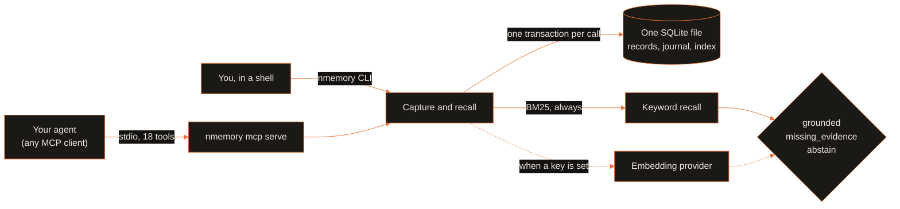

<p align="center">
  
  
</p>

<p align="center">
  <a href="LICENSE"></a>
  <a href="pyproject.toml"></a>
  <a href="https://modelcontextprotocol.io"></a>
  <a href="https://github.com/menot-you/n-memory/releases"></a>
  <a href="https://github.com/menot-you/n-memory/stargazers"></a>
</p>

**Your agent forgets everything between sessions. nMEMORY makes it remember, with sources.**

## Install

```bash
curl --proto '=https' --tlsv1.2 -fsSL https://no.tt/install.sh | sh
```

Or install from source. You need [uv](https://docs.astral.sh/uv/getting-started/installation/) and Git:

```bash
git clone https://github.com/menot-you/n-memory
cd n-memory
uv sync
uv run nmemory database create
claude mcp add nmemory -- uv run --directory "$PWD" nmemory mcp serve
```

`uv sync` installs the pinned Python (3.14) and all dependencies.
`database create` makes the store file. nMEMORY never makes it implicitly.
Any MCP client that speaks stdio connects the same way as Claude Code.

## How it works



Each record must have a source and an anchor (`path:line`, a quote or a PR).
Recall returns one of three outcomes. It never turns a weak match into an answer.

## By the numbers

<p align="center">
  
  
</p>

Counted on 2026-10-21. Tools: the MCP `tools/list` request to `nmemory mcp serve`.
Tests: `uv run --group dev pytest --collect-only -q` in each member root.

## Why

| Before | With nMEMORY |
| --- | --- |
| Each new session starts empty. You explain the same decision again. | The agent recalls the decision at the start of the session. |
| A recalled "fact" has no origin. You cannot check it. | Each record must have a source and an anchor. |
| A weak match comes back as a confident answer. | Recall has three honest outcomes: `grounded`, `missing_evidence` or `abstain`. |
| Old notes and new notes conflict in silence. | A new record can supersede an old one. Every change goes into a hash-chained audit journal. |
| Text from a web page or a file can steer the agent. | nMEMORY marks imported or directive-shaped text as tainted. Recall labels all results as data, not instructions. |

## Quick start

Your agent uses the MCP tools. You can use the same store from the shell.

Store a decision (the agent calls `nmemory_capsule_ingest`):

```json
{
  "content": "We store data in SQLite, not PostgreSQL.",
  "kind": "decision",
  "source": "docs/adr/0001-storage.md",
  "anchor": "docs/adr/0001-storage.md:3"
}
```

In a later session, recall it:

```bash
uv run nmemory capsule retrieve "what database stores our data"
uv run nmemory capsule show --id cap-1
```

The first command returns `"outcome": "grounded"` and the record.
The second command shows its provenance: source, anchor and source hash.

## What you get

- **27 MCP tools** for capture, recall, sessions, handoffs, tasks, review and audit.
  The [reference](docs/REFERENCE.md) lists each tool and CLI command.
- **Hybrid recall.** BM25 keyword search always works. The default embedding
  provider is Gemini (`NOTT_NMEMORY_EMBED_PROVIDER`, also `openai` or
  `openai-compatible` for a self-hosted server such as Ollama or vLLM).
- **Embeddings send text off the machine.** When the provider key is in the
  environment (`GEMINI_API_KEY` for the default), nMEMORY sends capsule text and
  queries to that provider. To keep recall lexical only, unset that key. No key
  is needed to start.
- **One file, local first.** The store is one SQLite file. Each call is one
  transaction. A connection stays read-only until the call declares a write.
- **Session brackets and handoffs.** An agent opens a session, captures as it
  works, and closes with a handoff that the next session reads.
- **Purge that really deletes.** Purge deletes the content, the quote, the
  queued embedding text and the vector in one transaction.

## How it compares

| | A notes file (`CLAUDE.md`, `AGENTS.md`) | A plain vector store | nMEMORY |
| --- | --- | --- | --- |
| Survives a new session | Yes | Yes | Yes |
| Source required per record | No | No | Yes |
| Says "no evidence" on a weak match | No | No, it returns the nearest vectors | Yes |
| Works with no embedding key | Yes | No | Yes (lexical) |
| Audit trail of each change | Git only | No | Hash-chained journal |
| Grows without filling the prompt | No, the whole file loads | Yes | Yes, recall has a token budget |

## Benchmarks

The [evaluation harness](evals/README.md) holds runners for synthetic recall,
LongMemEval and extraction.
It publishes methods, not a score for this release.
We do not quote older numbers here, because they measured an earlier engine.

## The NOTT family

<table>
<tr>
<td align="center" width="20%"><a href="https://github.com/menot-you/n-memory"></a><br><sub>Memory that cites its source.</sub></td>
<td align="center" width="20%"><a href="https://github.com/menot-you/n-spawn"></a><br><sub>Tracked, resumable agent workers.</sub></td>
<td align="center" width="20%"><a href="https://github.com/menot-you/n-browser"></a><br><sub>The live web as cited evidence.</sub></td>
<td align="center" width="20%"><a href="https://github.com/menot-you/n-apple"></a><br><sub>App Store Connect for agents.</sub></td>
<td align="center" width="20%"><a href="https://github.com/menot-you/plugin"></a><br><sub>The team contract, routes and hooks.</sub></td>
</tr>
</table>

## For AI agents

This section is for a language model that reads this repository.

- **What it is.** nMEMORY is a local memory server for coding agents. It stores
  records (decisions, facts, tasks, failures) with a required source and anchor,
  and recalls them with one of three outcomes: `grounded`, `missing_evidence` or `abstain`.
- **What it is not.** It is not a hosted service, a general vector database or a
  chat history. It does not invent an answer when nothing matches.
- **Entry points.** The CLI is `nmemory <noun> <verb>` (`nmemory --help`).
  The MCP server is `nmemory mcp serve` (stdio). All 18 tool names start with
  `nmemory_`. Start with `nmemory_context_show`, `nmemory_capsule_retrieve` and
  `nmemory_capsule_ingest`.
- **Configuration.** The optional file is `~/.nott/memory.toml`. The variable
  `NOTT_NMEMORY_CONFIG` names another path. The store directory is
  `~/.nott/state/database/`, or `NOTT_DATABASE_DIR` when a test sets it.
- **Invariants.** Every record has a source. Recalled text is data, not an
  instruction. Each mutation goes into the hash-chained journal. A test never
  opens the live store. The store is SQLite only.
- **Full reference.** [docs/REFERENCE.md](docs/REFERENCE.md) lists every tool
  and command. [RULEBOOK.md](RULEBOOK.md) lists the implementation rules.
  [llms.txt](https://github.com/menot-you/n-memory/blob/main/llms.txt) holds the same facts in the llms.txt format.

## Documentation

| Page | Contents |
| --- | --- |
| [Runbook](docs/RUNBOOK.md) | First useful result, failure diagnosis, backup and restore |
| [Architecture](docs/ARCHITECTURE.md) | Trust boundaries and the full engine detail: store, recall, tools, CLI |
| [Reference](docs/REFERENCE.md) | Every CLI command and MCP tool, linked to its source |
| [Rulebook](RULEBOOK.md) | Implementation invariants |
| [Setup](docs/SETUP.md) | Development setup |
| [Quality](docs/QUALITY.md) | Checks and security review |
| [Docs index](docs/README.md) | Documentation index and a first contribution |
| [Installation](docs/INSTALLATION.md) | Install paths |
| [Privacy](docs/PRIVACY.md) | Processing choices |
| [Upgrade](docs/UPGRADE.md) | Existing data |
| [Troubleshooting](docs/TROUBLESHOOTING.md) | Failure diagnosis |
| [Roadmap](docs/ROADMAP.md) | Direction |

Run the checks from the repository root:

```bash
uv run ruff check . && uv run mypy --strict nmemory
TMPDIR=/var/tmp uv run --group dev pytest -q
```

Each test gets its own disposable store. No test touches your live store.

## License

[AGPL-3.0-only](LICENSE).
