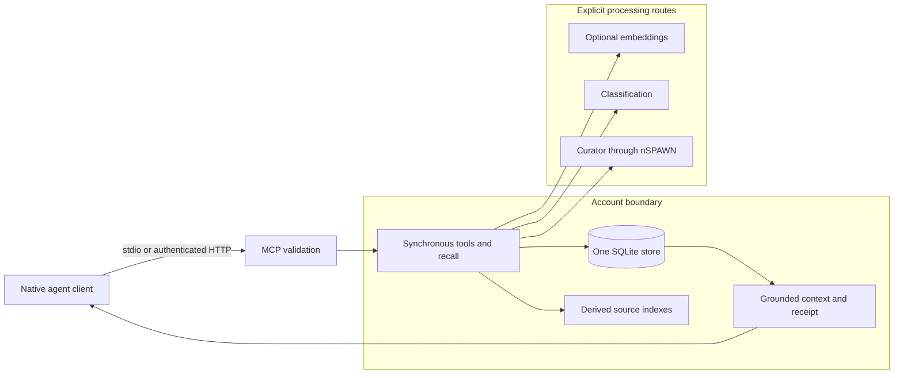

# nMEMORY architecture

A capture records source, authority, project, and taint.
Recall applies eligibility fences before it returns evidence.
A correction records a supersedes relation and preserves the older record.
Local storage does not imply local processing.
Embedding, System1, curator, and native client routes can use external services.
Curator inference uses nSPAWN's recorded native lifecycle.

[server.py](../nmemory/server.py) owns the MCP boundary.
[store.py](../nmemory/store.py) owns transaction composition.
The [rulebook](../RULEBOOK.md) owns implementation invariants.
The account owns its store. MCP transport authentication does not grant an operation extra authority.

Use the [runbook](RUNBOOK.md) for setup, failure diagnosis, backup, and restoration.
The [reference](REFERENCE.md) links each public interface to its source.
