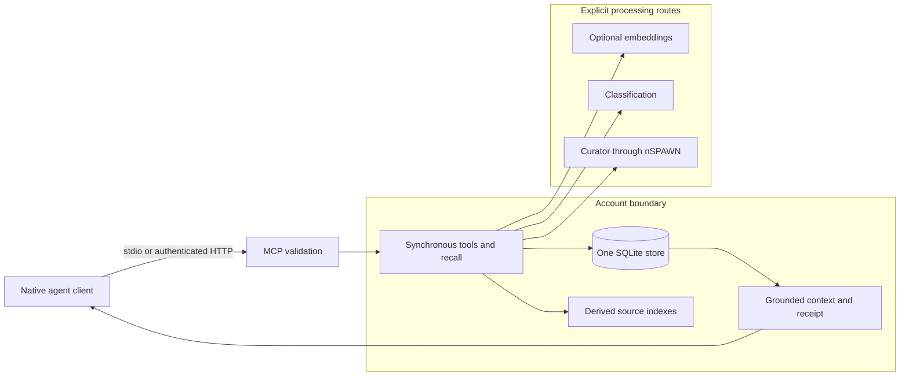

# nMEMORY architecture



A capture records source, authority, project, and taint.
Recall applies eligibility fences before it returns evidence.
A correction records a supersedes relation and preserves the older record.
Local storage does not imply local processing.
Embedding, System1, curator, and native client routes can use external services.
Curator inference uses nSPAWN's recorded native lifecycle.

[server.py](../nmemory/server.py) owns the MCP boundary.
[store.py](../nmemory/store.py) owns transaction composition.
The [rulebook](../RULEBOOK.md) owns implementation invariants.
The account owns its store. MCP transport authentication does not grant an operation extra authority.

Use the [runbook](RUNBOOK.md) for setup, failure diagnosis, backup, and restoration.
The [reference](REFERENCE.md) links each public interface to its source.

## Engine detail

This section was the component README. It keeps the full engine description.

System1 uses the shared configuration lookup of the `nott-system1` package.

### 1. Architecture & Live Topology

- **Primary Store**: one SQLite file, `nmemory.sqlite3`, in the account's store directory, opened only through `nott_database.connect`. Embeddings are float32 BLOBs (3072 dimensions) searched with `sqlite-vec`'s `vec_distance_cosine`.
- **Lexical Engine**: In-process BM25 lexical token ranking with diacritic folding over the durable store.
- **Fail-Closed Store Selection**:
  - The store directory is `NOTT_DATABASE_DIR` when a test or a parent that rewrites the child's HOME sets it, otherwise the account's live directory. `nmemory database create` makes the file; nothing else creates it, and a missing file is a typed refusal.
  - Every connection is `query_only`; one transaction per tool call, and only a declared write lifts it.
- **Communication Doors**:
  - **MCP stdio**: JSON-RPC 2.0 protocol over standard I/O (`nmemory mcp serve` or `python -m nmemory mcp serve`).
- **Embedding Worker**:
  - `NOTT_NMEMORY_EMBED_PROVIDER` picks the space: `gemini` (default, `gemini-embedding-2`, `GEMINI_API_KEY`), `openai` (`text-embedding-3-large`, `OPENAI_API_KEY`) or `openai-compatible`, a self-hosted server speaking the OpenAI embeddings protocol (Ollama, vLLM). The last needs `NOTT_NMEMORY_EMBED_ENDPOINT` (the full http(s) `/v1/embeddings` URL), `NOTT_NMEMORY_EMBED_MODEL` and `NOTT_NMEMORY_EMBED_DIMENSION` (the model's native size, at most 3072). It sends no key and zero-pads the native vector to 3072 (cosine unchanged). Any vector, from a provider, a hook or a batch file, of another size, with a non-finite component or with no direction is refused. A recall's query embedding makes one attempt within a 3 s elapsed-time deadline before going lexical; indexing keeps 120 s and its retries. An unknown provider, a missing variable or a malformed endpoint never stops the server: it starts with the vector lane off, logs a warning, refuses the OpenAI batch lane, and `embedding show` reports `lexical_only` with `last error config_error`, pending jobs or not.
  - The space fingerprint `provider:model:dimension:nmemory-retrieval-v1` names the model and its native size (3072 for Gemini and OpenAI), so changing either re-embeds every capsule and never mixes spaces.
  - Features asynchronous queue drain (`nmemory.embedding_jobs`), atomic completion guards, automatic space transition reindexing, and `embedding_usage` telemetry.
  - Without a key or endpoint, lexical retrieval operates without embeddings. A provider that refuses until an operator acts (exhausted balance, monthly spending cap) is not retried; a per-minute rate limit still is: recall falls back to lexical at once, the worker logs a warning, and `embedding show` reports phase `lexical_only` with `last error quota_exhausted` until a vector lands again. A recall whose query embedding fails sets `lexical_only` too (`last error query_embedding_failed`), and the next recall that embeds clears it. A worker claims and completes only jobs of its own client's space, so two servers on different models during an install never label each other's vectors. Every client error is truncated and redacts the configured key, `key=` values and `Bearer` tokens.
- **Tool-call record**:
  - Every answered `tools/call` writes one structured stderr line — tool name, outcome, duration, result line count. A read-only server writes none.
  - Outcome keeps the two error channels apart: `ok`, `refused` (in-band `isError`), `fault` (JSON-RPC error).
  - **Logging**: the stdio door installs the package's only logging handler, bound to **stderr** — stdout is the MCP protocol channel, and one stray byte there fuses into the next frame and is silently discarded. Records are one JSON object per line.

#### Layers

The package has four layers, outer to inner, and an inner layer never imports an
outer one: the doors (`server`, `cli`, `serve`, `__main__`), the application
(`tools/`, `commands/` and the services), the infrastructure (the SQLite
`database`, `store` as the Unit of Work, `repositories/`, `queries/`, the embedding
space and the adapters) and the pure domain. Which module sits in which layer is
written once, in the `layers` contract of `[tool.importlinter]` in `pyproject.toml`,
and `tests/test_architecture.py` runs `lint-imports` against it. The contract is
exhaustive: a new module that is not listed there fails.

#### Validation, audit, and recall

`nmemory/capsule.py` rejects empty content or provenance, an empty project ID,
an invalid authority class, confidence outside `[0, 1]` (including NaN), and a
validity interval whose end precedes its start. The store keeps canonical writes
in one transaction per tool call; a write must be declared before the read-only
connection is lifted. `nmemory/journal.py` verifies the append-only audit chain,
its sequence, and the recorded boundary between historical hash formats.

Purge removes the source quote, content slug, queued embedding text, and vector
in the transaction that destroys the capsule content. Embedding transmission
checks the current job under the store lock before each attempt. Delayed results
cannot restore a purged vector. Concurrent captures preserve the insertion
winner's provenance, quote, taint, capture context, and event time.
They also preserve its classification and evidence fields. A repeated handoff
that matches a tombstone does not prevent session completion. The session keeps
its new summary and returns a warning without a handoff reference.

`nmemory/retrieve.py` expands known synonyms, combines lexical BM25 and vector
ranks with reciprocal rank fusion, applies the eligibility fences, and records a
recall receipt. A capsule's 180-day decay clock starts at its last passing
verification; without one, decay is neutral. A pin also keeps decay neutral.
The retrieval code owns the exact fence order and score formula.

---

### 2. The 24 Real MCP Tools

The server exposes exactly the 24 tools specified in the canon (`src/server/mod.rs`):

1. `nmemory_session_start`: Start a session, detect store health, and return session status.
2. `nmemory_capsule_ingest`: Ingest structured facts, decisions, constraints, tasks, and procedures.
3. `nmemory_capsule_show`: Retrieve a capsule by ID or handle with provenance and anchor status.
4. `nmemory_kind_classify`: Deterministic kind derivation, scope assignment, and taint detection.
5. `nmemory_turn_extract`: Pure non-LLM candidate extraction from free-text blobs.
6. `nmemory_capsule_retrieve`: Dual-lane hybrid recall with RRF fusion times an exponential decay (the writer's confidence does not rank), exclusions, and receipts.
7. `nmemory_relation_add`: Record directional ontological graph edges (`supersedes`, `derived_from`, `blocks`, `dod_of`, etc.).
8. `nmemory_capsule_pin`: Pin or unpin critical memories against consolidation demotion.
9. `nmemory_capsule_reanchor`: Rebind anchor paths after file moves or refactors.
10. `nmemory_synonym_add`: Teach domain synonyms and abbreviations for expanded lexical recall.
11. `nmemory_capsule_consolidate`: Deterministic consolidation planning (exact dupes, token containment, tier moves).
12. `nmemory_outcome_record`: Record real observed execution outcomes linked to capsules and receipts.
13. `nmemory_outcome_list`: List the newest outcomes, newest first (`limit` 1 to 500, default 50, and an optional `project_prefix`). It writes nothing.
14. `nmemory_capsule_list`: List capsules filtered by project, kind, or pagination limits.
15. `nmemory_digest_show`: Generate verified store summary with audit chain status.
16. `nmemory_capsule_export`: Render deterministic generated Markdown store projection.
18. `nmemory_project_bootstrap`: Bootstrap working context with constraints, decisions, and pitfalls.
19. `nmemory_context_show`: Extract and index active session context.
20. `nmemory_index_build`: Explicitly index files or git commits.
21. `nmemory_capsule_import`: Batch import external memories with provenance and taint tracking.
22. `nmemory_capsule_purge`: Cryptographically tombstone and redact or purge capsule content.
23. `nmemory_dod_set`: Manage Definition-of-Done lifecycle across status and verdict axes.
24. `nmemory_session_finish`: Close a session and persist summary handoff capsule.

#### Enumerating open work

`nmemory_work_list` reads canonical open tasks and DoDs beyond the five-row
context preview. Pass `project_id` and `limit` (1–100); `subtree: true` includes
descendants, while omission selects only that exact project. The response is
`{rows: [...], next_cursor: string | null}`, oldest capsule first. Rows contain
`id`, `kind`, `handle`, `age_days` and a short headline; tainted rows withhold
the headline and slug. `null` means the enumeration ended. Optional
`headline_prefix` selects a literal, case-sensitive first-line prefix (1–140
characters); SQL filters before the page limit, and tainted records never match:
a prefix test over a tainted body would let a caller read it back byte by byte.
Optional `source` selects records whose `provenance.source` equals it exactly
(1–256 characters, which keeps every continuation cursor decodable; no prefix,
wildcard or case folding), tainted records included; their rows still
withhold headline, slug and content and carry
`instruction_taint: true`. A source match is not proof of ownership: any writer
to the project can record the same source, so a reader still judges each row.
`include_content: true` adds each untainted record's complete `content`; omission
keeps the existing row shape. Tainted bodies are always withheld. Pages fit the
workflow client's 4 MiB reply ceiling, with room for the MCP envelope, so a page
may contain fewer rows than requested. One oversized record is refused rather
than truncated; omit `include_content` to enumerate its summary.

Pass `next_cursor` unchanged with the same scope, prefix, source and content
options to continue; a cursor with any of them changed is refused. A canonical write
invalidates the cursor: restart collection after the explicit stale-cursor
refusal. Collect every page before updating work. Live `witnesses` and
`supersedes` relations close work; an outcome observation alone does not.
The query neither claims exclusive ownership nor orders work by priority.

#### Viewer mode

`nmemory mcp serve --viewer` serves the app's Memory page. It admits only
`nmemory_capsule_list`, `nmemory_capsule_retrieve`, `nmemory_capsule_show` and
`nmemory_outcome_list`, and refuses every other tool as unknown. Its reads count
nothing: no `read_traffic` row, no `usage` recall, no receipt, no recall-miss
row and no embedding phase, so a page read does not change what recall serves an
agent. It starts no
embedding worker and no curator. Its vector lane stays, so a viewer search and an
agent search give the same results. `--viewer` and `--read-only` exclude each
other.

#### Inherited sessions

Only the main session reads or writes nMEMORY. nSPAWN
marks each child and workflow run with `NOTT_NSPAWN_RUN_ID`. When that variable is
set, a stdio server refuses every tool call before store access, and the CLI refuses
every verb except `mcp serve`. The shared HTTP server cannot see the marker, so on a
host that uses it only the plugin hook refuses a Claude child. This refusal applies before the capture policy
below. The plugin hook `nmemory-main-only.py` denies the calls of a Claude
subagent, which shares the server of its main session. The hook refuses tool calls
only: a Claude subagent that runs the CLI through Bash stays open until a later
change. On Codex, only an nSPAWN child is covered. A Codex `multi_agent` sub-agent shares the server of its main
session, and no hook denies its calls.

#### Capture policy for managed app sessions

`NOTT_MEMORY_POLICY=push` selects a capture endpoint for an app-managed session
and its children. The server reads this policy at construction. An unknown value
refuses startup.

The endpoint admits only `nmemory_capsule_ingest`, `nmemory_outcome_record`,
`nmemory_session_start`, `nmemory_session_finish` and `nmemory_relation_add`.
Every other tool refuses before store access. An empty `nmemory_outcome_record`
call also refuses because it requests stored outcomes.

Capture keeps validation, provenance, authority, taint, audit and atomic writes.
Replies contain only receipts for the current input. They omit handles,
similarity data, prior content, store health and DoD data. A handoff warning keeps
only the fixed `handoff_validation` marker. A failed handler returns a refusal
and cannot acknowledge a capture.

Read-only, viewer and HTTP modes refuse this policy before store access.
Non-server CLI commands also refuse. The ordinary owner viewer runs without
this key. Restart with the key absent to restore ordinary behavior. This policy
changes no stored record or schema.

#### Reading the board

`nmemory_board_show` puts each live task of one project in one column. The first
rule that matches wins:

1. `dropped`: a live incoming `supersedes` edge.
2. `done`: a live incoming `witnesses` edge.
3. `doing`: a live `dod_of` edge from a live DoD that no live edge supersedes and
   whose latest status is `accepted`.
4. `blocked`: a live incoming `blocks` edge from an open, live task.
5. `ready`: every other task.

Pass `project_id` and `limit` (1–100 cards in each column). The totals are always
exact. `capsule_id` returns only the card of that task, and the tool refuses a
capsule that is not a task of the project. A card gives `id`, `handle`, `headline`,
`session` (the `capture_context` session, or null), `blocked_by`, `doing`,
`closed_by` and `outcome`. A tainted task or closer gives its bare id and no
text. `pending` lists the staged GitHub changes that wait on the owner, by
proposal id and task id only.

#### Protocol Compliance & Teaching Error
Unrecognized tools return JSON-RPC error code `-32602` (`INVALID_PARAMS`) with teaching error:
```
unknown tool "<name>" — tools/list names the 24 valid tools
```

---

### 3. CLI Command Suite

The command table in `nmemory/cli.py` is the grammar; `nmemory --help` is
generated from it, and a spelling outside it is refused as unknown. The
exception to the storeful commands is named below the block.

```
nMEMORY MCP server and CLI; every command also takes --project P.

usage: nmemory <noun> <verb> [arguments]   (nmemory --help lists every command)

  nmemory mcp serve [--project P] [--read-only | --viewer]
      serve MCP on stdio
  nmemory database create
      create an empty store at the store path (never overwrites)
  nmemory database snapshot DEST
      copy the store, compacted, into DEST (VACUUM INTO; refused if DEST exists; takes no writer lock)
  nmemory capsule retrieve [QUERY] [--terms T] [--limit N] [--budget N] [--project-prefix P] [--known-at T]
      query the recall engine directly (dod excluded; capsule show for a known id)
  nmemory capsule show --id REF
      one capsule by reference
  nmemory capsule list --pinned [--json | --full]
      list up to 60 live pinned headlines, newest first, and the count left out (--json: every one as JSON lines; --full: every owner rule with no row cap, in full while room lasts)
  nmemory rule write
      write the live rules to ~/.nott/RULES.md, ~/.nott/projects/ and ~/.nott/agents/
  nmemory capsule export [--no-stamp]
      render the markdown generated view
  nmemory capsule relate --kind K --from REF --to REF [--revoke --actor A --reason R]
      record, or revoke, a semantic relation between capsules
  nmemory capsule audit [--json] [--apply]
      check obsolescence conditions (--apply records verification events)
  nmemory digest show [--project-prefix P]
      print the store digest
  nmemory context search [QUERY] [--source S] [--limit N] [--budget N]
      low-friction unified context search (markdown, code, git and rustdoc)
  nmemory index build [--root DIR] [--source S] [--retire-root DIR]
      explicit context indexing; retire an earlier checkout after a complete build
  nmemory github sync [--verify] [--config F] [--repo R] [--label L] [--max-writes N] [--effort REF]
      mirror the nMEMORY planning graph to GitHub issues
  nmemory anchor list
      print the live capsule anchor index
  nmemory anchor check [--drain | --all] [--root DIR] [--spool DIR] [--json]
      judge code anchors against the working tree and record verification events
  nmemory quality measure [--json] [--dry-run]
      measure store hygiene and capture the result as a capsule
  nmemory review run --daily
      the daily curator review
  nmemory embedding show [--json]
      embedding status
```

#### `github sync`: the declared fence

GitHub issues are a window onto the planning graph, written from it.
**Which** capsules enter through the window is declared in
`~/.nott/memory.toml`:

```toml
[github]
repo = "<owner>/<repository>"
label = "nmemory"
project = "<project>"
efforts = ["cap-<id>"]     # the mirrored epics
```

`efforts` is the key that matters. Each entry is the cap-id of a live
epic with members; the sync mirrors that subtree and **leaves the rest of
the graph alone** — it neither creates, nor closes, nor reports. A capsule
that already has an issue and fell outside the fence is left intact, on
purpose.

Without `efforts` and without `--effort`, the **application refuses**.
Measured on 2026-09-21: an unfenced run against this store proposed 2080
creations. `--verify` still runs without a fence — it writes nothing and
is how the whole graph gets measured.

The configuration lives here, and not in `.nott/nmemory/config.toml`,
because this path is **absolute**: the repository's is relative to the
working directory and only loads if it exists, so a process started in
the wrong place would find no configuration, gain no fence, and silently
propose the whole graph. `--config` still serves as an explicit override,
and flags win over both files. An `--effort` **replaces** the declared
list, never merges into it.

#### `github sync`: the pull

The mirror is two-way for task issues only. Before an apply run
writes, it pulls: each change that another GitHub user made to a task issue
becomes a staged, tainted proposal about that task. The owner approves or rejects
it in the NOTT app board. Until then, the proposal does not change the board.

- The pull ignores the events, edits and comments of the sync's own login
  (`gh api user`).
- It reads the timeline and the body editor only of issues that changed after the
  watermark: `pulled_at=` in the newest complete `github-sync` audit line. Comments
  come from one `issues/comments?since=` read. Only a complete run moves the
  watermark.
- Each change is one ingest: `kind: fact`, `authority_class:
  externally-imported`, `staged: true`, `source: github-pull`, `anchor:
  github:<repo>#<n>`, then an `about` edge to the task. Proposals count against
  `--max-writes`.
- The content is one line of tokens that GitHub validates:
  `GitHub change: <repo>#<n> <field> <action> by @<login> at <time> (<event|comment|edit> <id>)`.
  The new value (title, label, comment, body without the sync footer, or the
  close reason) goes only in `source_quote` and `derived_from`. A body whose sync
  footer is not exact has the action `edited-footer` and keeps the whole body.
- While a change to the state, title, body or sync-owned labels waits, the sync
  does not write that field of that issue, and the report prints
  `held #<n> <field>`. After a rejection, the next run writes the board back:
  it reopens or closes the issue, and retitles, rebodies or relabels it.
- `--verify` stages nothing.

---

### 4. Quickstart & Verification

#### Running the checks

Run these from the nMEMORY project root.

```bash
uv run ruff check . && uv run ruff format --check . && uv run mypy --strict nmemory
TMPDIR=/var/tmp uv run --group dev pytest -q
```

The test plugin gives every test its own `NOTT_DATABASE_DIR`; no test reaches the live store.

#### Lexical ranking boundary

`nmemory.lexical` owns normalization and pure BM25 scoring; `Store` owns the
store snapshot, eligibility fences and sequence tie-breaking. Scores use
all live documents for average length and document frequency, including documents
outside the requested scope. Filtering the corpus before computing these statistics
would change the public `bm25` values.

The bounded content cache retains immutable term frequencies alongside the existing
token cache. Repeated searches reuse those frequencies; no cached corpus membership
or global statistics can hide another writer's append or purge. The independent
oracle in `tests/test_lexical_ranker.py` checks scores and scope semantics over
generated corpora, and its native test observes append and purge through the SQLite store.

The term index (`term_postings`, `term_documents`, `term_index_state` in
`nmemory/database.py`) stores the tokens of each live capsule by word. A search
reads the postings of its query words and parses only the capsules it returns.
Ingest and forget keep the index in their own transaction. A writable open
builds the index of an existing store in short transactions, and recall scans
every capsule until the index is complete. `tests/test_term_index.py` compares
the scores and the order of both paths after random ingest, supersede, forget
and purge sequences.

#### Conditional capture

`nmemory_capsule_ingest` accepts optional `expected_revision` on a capture item.
The value names the latest capsule for the exact project, provenance source and anchor.
An explicit `null` requires that no revision exists. Omission keeps ordinary ingest.
The comparison and capture share the existing write transaction.
Two writers that name the same prior revision can produce only one accepted successor.
The other receives a stale revision refusal before capture.
The caller supplies `supersedes` when the new capsule replaces the prior capsule.

#### Repository fact proposals

Run `nmemory project scan --root <repo> --project <project>` to propose repository facts.
The root must equal `NOTT_NMEMORY_ANCHOR_ROOT`, or the current project directory when that variable is absent.
The scan uses one read-only nSPAWN session on the configured curator route.
Only facts with verified source quotes enter the store as staged proposals.
The command prints their capsule IDs.
Use `nmemory_proposal_review` to ratify or reject each proposal.
The daily curator leaves repository scan proposals pending.
Ordinary recall excludes proposals until review ratifies them.
