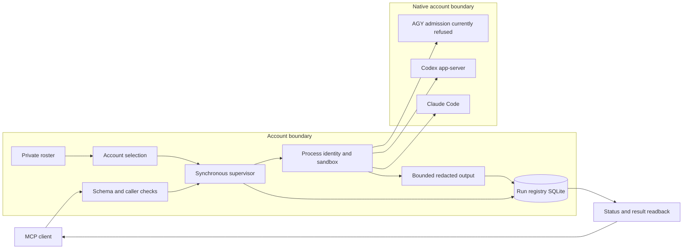

# nSPAWN architecture

The roster names existing accounts and binaries. It does not contain credential values.
The supervisor records requested and executed routes separately.
It checks process identity before signals and reads surviving processes back before claim release.
The output pump redacts before it persists transcript bytes.
The terminal classifier requires vendor evidence. Exit code zero alone does not prove success.

[supervisor.py](../../../packages/nspawn/nspawn/supervisor.py) composes the lifecycle.
[child.py](../../../packages/nspawn/nspawn/child.py) owns process custody.
[driver.py](../../../packages/nspawn/nspawn/driver.py) lets admitted runs outlive the caller.
The [rulebook](../../../packages/nspawn/RULEBOOK.md) defines layer direction and admission invariants.
A native account login and a working classification endpoint prove different prerequisites.
The native clients can send task text to their configured providers.

Use the [runbook](RUNBOOK.md) for setup, failure diagnosis, backup, and restoration.
The [reference](REFERENCE.md) links each public interface to its source.
