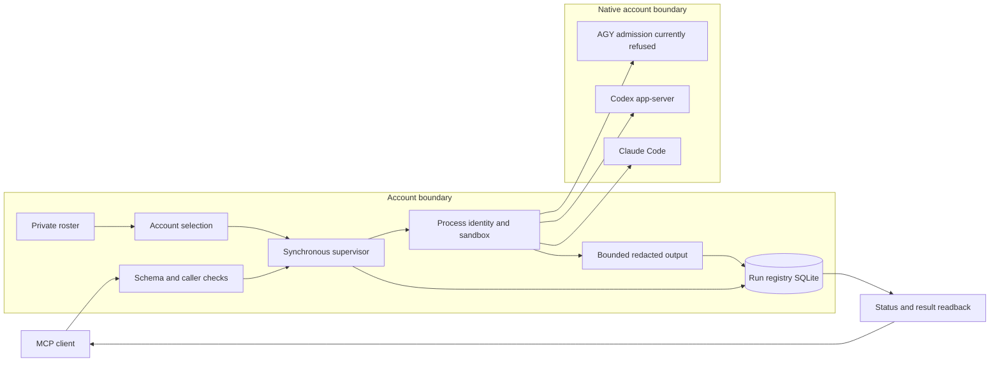
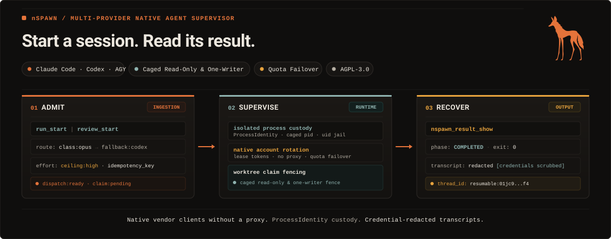
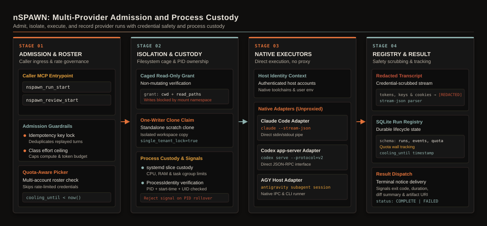
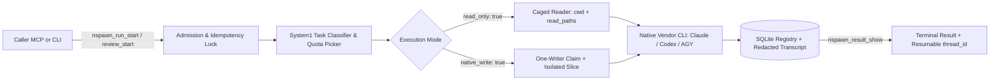
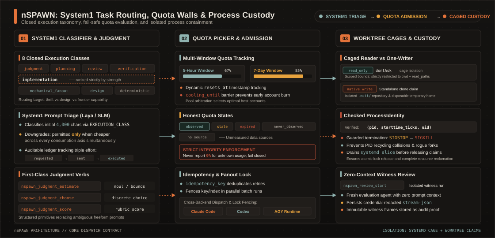
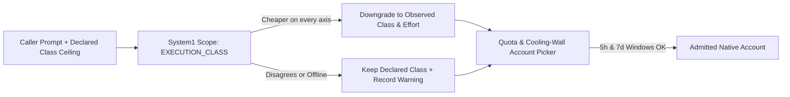

# nSPAWN architecture



The roster names existing accounts and binaries. It does not contain credential values.
The supervisor records requested and executed routes separately.
It checks process identity before signals and reads surviving processes back before claim release.
The output pump redacts before it persists transcript bytes.
The terminal classifier requires vendor evidence. Exit code zero alone does not prove success.

[supervisor.py](../../../packages/nspawn/nspawn/supervisor.py) composes the lifecycle.
[child.py](../../../packages/nspawn/nspawn/child.py) owns process custody.
[driver.py](../../../packages/nspawn/nspawn/driver.py) lets admitted runs outlive the caller.
The [rulebook](../../../packages/nspawn/RULEBOOK.md) defines layer direction and admission invariants.
A native account login and a working classification endpoint prove different prerequisites.
The native clients can send task text to their configured providers.

Use the [runbook](RUNBOOK.md) for setup, failure diagnosis, backup, and restoration.
The [reference](REFERENCE.md) links each public interface to its source.

## Full design and contract

This section is the full technical text that the README held before the launch rewrite.



**Multi-provider supervisor, System1 task router, and SQLite run registry for native AI coding agents.**
`nSPAWN` dispatches, isolates, and tracks Claude Code, Codex `app-server`, and AGY runs on your existing authenticated accounts.
It adds System1 (`Laya` / `Jev` or local SLM) routing, quota-wall protection, process custody, and credential-redacted transcripts.

---

### Why nSPAWN exists

Ad hoc shell subagents die when the parent terminal closes, overwrite shared worktrees, hit account rate limits mid-task, or leak secrets into logs.

| Without nSPAWN | With nSPAWN |
| --- | --- |
| Subagents die when the caller terminal closes or leave orphan processes behind. | Each run executes in its own driver process and systemd slice, and survives caller restarts. |
| Expensive reasoning models run on mechanical tasks while complex tasks starve. | System1 (`Laya` / `Jev` or local SLM) classifies the prompt and routes across 8 execution classes. |
| Parallel writers collide in the same Git checkout. | Read-only runs execute in a strict cage, and writable runs take an exclusive one-writer claim. |
| Hitting a 5-hour or 7-day quota wall aborts the whole workflow. | The roster tracks per-account utilization and `cooling_until` walls, and routes around exhausted accounts. |
| Independent code review shares the author session's biased context. | `nspawn_review_start` starts a fresh read-only witness session with zero shared context. |
| Raw vendor streams can expose tokens or environment secrets. | Transcripts pass through credential redaction before persistence in the SQLite run registry. |

---

### System anatomy and execution flow



`nSPAWN` separates caller admission, System1 task classification, account selection, process custody, and result readback across eight explicit layers (`L1`–`L8`).



- **Native vendor clients, never a proxy:** each route runs its own native adapter on your authenticated host accounts.
- **Checked process identity:** every stop or kill checks `ProcessIdentity` (`pid`, start time, and `uid`) before sending a signal.
- **Honest effort and quota reporting:** admission records `requested`, `sent`, and `executed` effort separately, and quota state distinguishes `observed`, `stale`, `expired`, `never_observed`, and `no_source`.

---

### Standout technical features



#### 1. System1 task-class routing and probabilistic judgment (`Laya` / `Jev` and local SLMs)

Every `nspawn_run_start` call declares an execution `class` from a closed vocabulary of eight task kinds:

- **Strength-ranked classes:** `judgment`, `planning`, `review`, `verification`, and `implementation` route by each provider's declared `strength` rank.
- **Thrift-ranked fanout:** `mechanical_fanout` routes by `thrift` rank so high-volume parallel tasks use fast, economical accounts.
- **Design and deterministic classes:** `design` routes by `design` rank (such as AGY visual/SVG generation), and `deterministic` expresses no model preference.
- **Automatic System1 prompt triage:** when the roster defines `[classes]`, `nSPAWN` sends the first 4,000 prompt characters to System1 (`laya-nott` or a local loopback `/v1/chat/completions` SLM). The run executes as the observed class only when it is cheaper on every axis, and records any disagreement in `warning`.
- **First-class probabilistic MCP tools:** callers query System1 directly through `nspawn_judgment_estimate` (`noul` probability), `nspawn_judgment_choose` (`choice` distribution), and `nspawn_judgment_score` (`score` and `confidence`).



#### 2. Multi-window quota picker and cooling walls (`nspawn_quota_show`)

Running multiple coding agents across personal or team accounts often hits vendor rate limits mid-campaign.
`nSPAWN` tracks utilization per provider and account alias:

- **5-hour and 7-day rolling windows:** records utilization percentages, `resets_at` timestamps, and `observed_at` freshness for each account.
- **Automatic cooling walls (`cooling_until`):** when an account hits a rate limit, `nSPAWN` fences that account until its reset window. It routes the next dispatch to a healthy account on the same provider.
- **Zero fabricated numbers:** `nspawn_quota_show` reports `observed`, `stale`, `expired`, `never_observed`, or `no_source`—never a fake `0%` standing in for an unmeasured account.

#### 3. Caged readers vs. one-writer worktree custody

- **Read-only cage (`read_only: true`):** confines the child process to `cwd` and explicit `--add-dir` `read_paths`. Under the Claude `dontAsk` cage, only read-only inspection commands run. The cage refuses scripts, interpreters, and writes without prompting.
- **Exclusive one-writer claim (`native_write: true`):** requires a standalone Git clone (`.git` directory, not a linked worktree) under an approved `[native_write]` root. The writer receives an isolated disposable `HOME` and `TMPDIR` under `cwd/.nott/disposable`, runs with network access disabled inside its systemd slice, and cannot mutate `.git`.
- **Checked `ProcessIdentity` and slice drain:** `nspawn_run_close` re-verifies `(pid, starttime_ticks, uid)` before sending `SIGSTOP` then `SIGKILL` to the process group, and empties the systemd slice before releasing the worktree lock.

#### 4. Independent zero-context witness reviews (`nspawn_review_start`) and batch fanout (`nspawn_batch_start`)

- **Fresh witness reviews:** `nspawn_review_start` starts a caged read-only branch review in a fresh session with zero shared context from the author session. You can pass a specialized reviewer agent (`nott:python-reviewer`, `nott:security-reviewer`, `nott:silent-failure-hunter`, `nott:pr-test-analyzer`).
- **Multi-provider fanout:** `nspawn_batch_start` dispatches one read-only prompt across multiple providers or accounts in parallel under composite idempotency keys (`key/0`, `key/1`, ...).

---

### Quickstart in 60 seconds

#### 1. Install from source

Use an approved source checkout or archive. Run from its repository root:

```bash
uv sync --group dev
uv run nspawn --help
```

Use the pinned Python version and root lockfile.
The [installation guide](../../INSTALLATION.md) explains prerequisites and client registration.
Source installation does not register an MCP server or supply a native account.

#### 2. Inspect the roster and start a bounded read-only session

Copy the credential-free roster template (`templates/nott/spawn.toml`) to `~/.nott/spawn.toml`, list the declared providers and quota state, and start one read-only run:

```bash
uv run nspawn database create
uv run nspawn provider list
uv run nspawn quota show
```

Dispatch a caged read-only session through MCP:

```json
{
  "tool": "nspawn_run_start",
  "arguments": {
    "cwd": "/path/to/repository",
    "read_only": true,
    "class": "review",
    "prompt": "Summarize the package entry points in two sentences."
  }
}
```

Read the terminal answer and vendor thread ID with `nspawn_result_show`, then release the run claim with `nspawn_run_close`:

```json
{
  "tool": "nspawn_result_show",
  "arguments": {
    "run_id": "<run_id>",
    "timeout_ms": 60000
  }
}
```

Follow the [runbook](RUNBOOK.md) for setup, configuration, operation, backup, and restoration.

---

### Capability overview

`nSPAWN` exposes **14 MCP tools** and CLI verbs across four operational areas:

| Area | MCP tools | What it solves |
| --- | --- | --- |
| **Dispatch and fanout** | `nspawn_run_start`, `nspawn_review_start`, `nspawn_batch_start` | Start one async run, start an isolated read-only branch review, or fan out one prompt across multiple providers. |
| **Lifecycle and readback** | `nspawn_run_show`, `nspawn_result_show`, `nspawn_transcript_show`, `nspawn_run_list`, `nspawn_run_close` | Poll or long-poll run status, read the final answer or redacted stream-json events, and release worktree claims. |
| **Roster and quota health** | `nspawn_provider_list`, `nspawn_quota_show`, `nspawn_route_ping` | Inspect declared models and efforts from the roster, read account utilization windows, and probe route liveness. |
| **System1 routing judgment** | `nspawn_judgment_estimate`, `nspawn_judgment_choose`, `nspawn_judgment_score` | Estimate binary probabilities (`noul`), choose across criteria (`choice`), and score outputs (`score`) via System1. |

The current policy refuses new and resumed AGY sessions when the host cage contract is not satisfied.
A sent effort value does not prove which effort the vendor executed.

---

### Test and check locally

Every test uses its own temporary SQLite registry and synthetic vendor fixtures:

```bash
TMPDIR=/var/tmp uv run --group dev pytest tests/test_owner_roster.py -q
uv run ruff check .
uv run mypy --strict nspawn
```

---

### Try it, give feedback, and contribute

We built `nSPAWN` for developers who orchestrate multi-agent workflows across Claude Code, Codex, and AGY with full process and worktree custody.

- **Try it on your workflow:** configure `~/.nott/spawn.toml`, run `nspawn_route_ping` to check your accounts, and dispatch a read-only review with `nspawn_review_start`.
- **Share feedback and bug reports:** open an issue if a vendor CLI update changes a stream-json frame, quota header, or sandbox flag. Include the observed redacted frame and client version.
- **Send a first contribution:** read the [documentation index](README.md) for a guided first task. Read [CLAUDE.md](https://github.com/menot-you/n-spawn/blob/main/CLAUDE.md), follow [setup](https://github.com/menot-you/n-spawn/blob/main/docs/SETUP.md), and run the checks in [quality](https://github.com/menot-you/n-spawn/blob/main/docs/QUALITY.md).

### Read and contribute

| Need | Page |
| --- | --- |
| Agent and contributor contract | [CLAUDE.md](https://github.com/menot-you/n-spawn/blob/main/CLAUDE.md) |
| Contributor development setup | [Setup](https://github.com/menot-you/n-spawn/blob/main/docs/SETUP.md) |
| Checks and security review | [Quality](https://github.com/menot-you/n-spawn/blob/main/docs/QUALITY.md) |
| Documentation index and a concrete first contribution | [Docs](README.md) |
| Setup, operation, backup, and restoration | [Runbook](RUNBOOK.md) |
| Services and trust boundaries | [Architecture](ARCHITECTURE.md) |
| Complete MCP and CLI inventory | [Reference](REFERENCE.md) |
| Installation | [Installation](../../INSTALLATION.md) |
| Processing choices | [Privacy](../../PRIVACY.md) |
| Existing data | [Upgrade](../../UPGRADE.md) |
| Failure diagnosis | [Troubleshooting](../../TROUBLESHOOTING.md) |
| Direction | [Roadmap](../../ROADMAP.md) |
| Changes | [Changelog](../../../CHANGELOG.md) |

Read [contributing](../../../CONTRIBUTING.md), [conduct](../../../CODE_OF_CONDUCT.md), and [support](../../../SUPPORT.md).
Report sensitive issues through [security](../../../SECURITY.md).
See [license](../../../LICENSE) and [citation](../../../CITATION.cff).

The [rulebook](../../../packages/nspawn/RULEBOOK.md) defines implementation constraints.

### Implementation contract

This section keeps the private tree's contract text beside the public overview.

nSPAWN executor supervisor and runtime.

`nspawn_run_start` also accepts `command` with an executable, argument array,
terminal dimensions and `centerId`. It resolves any executable on PATH in the
recorded project. It records the executable path and file identity before launch.
A private execution guard checks that identity immediately before normal path
execution. Scripts retain their normal `$0` path and can read adjacent files.
Native provider executables use their existing account routes. Qwen and Strife
remain refused. There is no command roster or public environment override.

Command sessions use the existing aggregate custody scope. The run records its
terminal ID, project and center. Host disconnects preserve the session. Output
enters the existing private transcript before it enters the terminal ring.
The private control door pages retained output by file offset. Reconnection also
retains byte offsets, input writer sequences and terminal modes. Explicit close
drains custody before it records closure. The target receives
`NOTT_MEMORY_POLICY=push` through its closed environment.

Registry version 7 adds the command backend. The upgrade preserves run rows,
event chains and guards. Rollback refuses while a retained command row exists.

`nspawn notice renew` and `notice ack` read their claim token through exactly one
of `--from-file <path>` or `--stdin`. The input holds one UTF-8 token, with an
optional final newline. A token file must be a regular file owned by the caller,
with mode `0600`. Symlinks and pipes are refused. The commands refuse the former
`--token` form without echoing its value. The node host sends its claim
tokens through stdin, so upgrade the host and nSPAWN together.

The provider's `kind` selects its executor: `claude` uses Claude Code,
`codex` uses Codex app-server, and `agy` uses AGY stream-json. FUGU Responses
profiles use `kind="codex"`. Native routes do not construct a Claude command
or inherit the Claude environment from roster defaults.

Admission currently refuses every new `agy` launch, new or resumed, until an
installed, reviewed outer cage proves the boundary. A run already admitted can
still be shown, listed and closed.

Native accounts are explicit `[provider.accounts.<alias>]` blocks in
`~/.nott/spawn.toml`. Codex and AGY accounts declare their existing `home`.
Codex accounts can also declare `sqlite_home`. An API account additionally declares `auth_env`
and `model_provider`, matching an existing Responses profile in that home.
The supervisor never copies credentials or changes their permissions.

The Linux native writer's connected socket correction and upgrade proof live in
the source workspace's native build recipe, `ops/codex/README.md`. That file is
not part of a public export. The recipe preserves the network-disabled
profile and addressed-sendto refusal. Activation selects only nSPAWN's declared
binary through `[bins].codex`.

A new write run requires the explicit `native_write` opt-in. Claude receives
`--permission-mode dontAsk` with its restricted Bash-only command and pinned
sandbox settings. A tool request without prior permission fails instead of
waiting for an operator. The mode grants no extra tool or filesystem access.
A `session_id` resume must repeat `native_write=true`. An `original_run`
continuation retains the recorded opt-in.

A Claude account can declare `home` as its existing Claude configuration directory.
Unconfined runs and non-SDK routes pass it as `CLAUDE_CONFIG_DIR`. They retain `HOME`.
An account without `home` retains the inherited Claude configuration directory.
The roster refuses duplicate declared Claude directories. A recorded alias route
refuses a changed directory instead of moving the session. Caged runs and SDK
nodes retain their private configuration directories. External session discovery
reads the inherited directory and each declared Claude directory.

An account with `auth_env = "ANTHROPIC_API_KEY"` and no base url sends an
Anthropic API key. The picker keeps it for Haiku models only: any
other model moves to the next account or route. A canvas node never starts on,
is recorded on or moves to such an account, and `route start` refuses a node
already recorded on one.

Each provider can set `excluded_accounts` to a list of account aliases. The picker
refuses these accounts, including explicit requests. `nspawn route start` and
`route show` also refuse a node made on an account before its exclusion. `route
wall` and `route switch` still record a wall on it, so the node host can move a
running node to another account. Excluded accounts never supply a reset time for
the remaining pool. An unknown exclusion alias is refused when the account list is
read for selection.

The picker spreads work over the accounts that are not excluded and not cooling
down. Each account gets a score from its stored quota windows and its live runs:
the unused share of its weekly window divided by the seconds to that reset, times
the unused share of its five-hour window, divided by 1 + its occupancy. A window
past its reset, or never observed, counts as empty and whole. Of Codex, only the
main `codex` limit counts: another limit meters one model, and its stored name
does not say which. The highest score wins. On a tie, the account with the oldest
last run wins. Among endpoint accounts (`base_url`, a capacity host such as
qwen), the declared order breaks the tie. A credential failover takes its next
account from the same score. A provider with `fill_first = true` does not
score: it takes the first account in declared order that has a free slot, so a
dormant host wakes only when the warm ones are full. A provider with
`named_only = true` runs only when the caller names it or one of its accounts.
A provider with `quota_source = "colab"` adds the compute-unit balance of
`colab usage` to `nspawn quota show` (`compute`, with its age in
`compute_updated`). `quota show` only reads the store, so it answers at once.
`nspawn quota record` reads the source and stores it; the
`ops/systemd/user/nspawn-quota-record.timer` user timer runs it every 60 s. A
reading older than 600 s is marked `compute_stale`, which also shows a dead
timer. A failed record keeps the last good reading and reports
`compute_failure` and `compute_failed_at`. A node on a cooling
account keeps its route, because its session is in that account's home. Its next
refused prompt walls the account. The node host then moves a Codex or AGY node
with the journal's copy of its conversation, and a Claude SDK node through `route
switch`.

### Swarms

A swarm is the runs of one dispatch, for example the two readers of one review
(owner, 2026-10-20). Give each run the same `swarm` name on
`nspawn_run_start` or `nspawn_review_start`. The run then carries the group
`swarm:<name>`. A swarm belongs to one caller session.

- A member holds its notice while a member of the same swarm and the same caller
  is not terminal. The member that ends last claims all notices of the swarm in
  one write and sends one notice. The notice gives each run id, phase and
  executed account. It gives the cause of each run that did not complete, and
  an ALERT line that names each member whose work did not succeed. The answers
  stay with `nspawn_result_show`.
- A failed member walks on. Its walk is the list of next routes and
  accounts it may take. For an unpinned member (of `nspawn_review_start` or
  `nspawn_run_start`), the walk is the preference order of its class, then the
  other accounts of its route. For a pinned member, the walk is the other
  accounts of the pinned route, and it is empty when the pin names an account.
  A preference entry that names an account adds no other accounts, so a
  `named_only` route serves only the accounts that the order names. A walk
  entry for an account names its provider too.
  A route refusal takes the next entry of the walk, each time. One failure that
  is not a route refusal also takes the next entry, one time per member. When
  the walk is empty, the failure goes into the notice. nSPAWN admits the next
  run before the failed run's terminal write, so the swarm waits for it.
- A member with no `timeout_ms` stops after 2 hours (`SWARM_TIMEOUT_MS`).
  nSPAWN does not start a member again after its deadline.
- nSPAWN marks the members delivered in one write after the send. A store
  refusal leaves the whole swarm to send again, never a part of it.
- When the caller session ends, the next session start of the project prints the
  swarm as one notice. The drain takes a swarm when the caller of one member
  is dead, or when its last member is stale. It groups by caller session and
  swarm name.
- A node door refuses `swarm`: the host takes a node's notices one by one.
- A caller-given `group` must not start with `swarm:`.
- A member that never starts is not a member: its dispatch returns the refusal.
- A member that ends before nSPAWN admits its sibling sends its notice alone.
  Dispatch the members in one turn.

### Who reviews and who judges

A review or a judge is never the agent that made the work (owner
direction). `nspawn_review_start` needs no `provider` and no `model`. A
`nspawn_run_start` of class `review` or `verification` needs neither. With no
`provider`, nSPAWN tries the routes in this order:

1. The roster's `[preference]` list for the class. Each entry is a declared
   provider or account alias, with an optional `/<model>`:

   ```toml
   [preference]
   review = ["claude/opus", "codex/gpt-6.1-sol", "claude"]
   verification = ["claude"]
   ```

2. For a review, the route `[roles]` binds to `reviewer`, with its
   `[role_profile.reviewer]` model and effort.
3. Every provider, in the class's rank, except a `named_only` provider.

`producer` names the author: route names, account aliases or model ids. nSPAWN
skips a preference that is the producer's route, account or model, and keeps
the run off the producer's accounts on a copy of the roster. It refuses a
pinned `provider` that is the producer. On a Claude route a producer's model
also excludes the family alias that runs it: `claude-opus-5-5` excludes `opus`
(with no catalogue to read, every `opus` id). A witness that names its producer
keeps its class: no classifier lowers it past this order. `producer` on any
other class is refused.

nSPAWN skips a preference that cannot serve now and records why: a wall that
has not lifted, a model the route does not serve, a fence or a preparation
refusal (the codex-main plugin cache fence), or any other refusal
of that route at admission. The run that serves carries the record in
`warning`, for example `review preference: skipped codex/gpt-6.1-sol
(NativePreparationError: ...)`. When no preference can serve, the refusal
names each one and its reason. It is `AllProvidersWalled` with
`nearest_reset` when a wall stopped a preference, else `PickerError`.

A route can also refuse the turn after admission: a model it does not serve
(codex-main answers HTTP 400 for `gpt-6.1-sol`), a spent balance (HTTP 402, or
Z.ai `1113`), a rate limit (HTTP 429), an organization that refuses the OAuth
account (HTTP 403 `oauth_org_not_allowed`), or a quota wall. nSPAWN is the
router (owner): an account, balance, quota or rate-limit failure is
its routing event for every run class, not the caller's. It walls what failed.
HTTP 401 and 403 wall the account for 300 s. HTTP 402 walls it for the hour, or
to the vendor's reset. HTTP 429 walls it for 300 s (`rate_limited`). A 429 on a
Claude route with no account walls the route for 300 s. A vendor code that the roster
declares in `exhausted_codes` walls the route for the hour. An undeclared code
is a 429 like any other.

A node turn that the organization refuses (`oauth_org_not_allowed`) gets the
same 300 s wall through `subscription_limit`, so `route switch` moves the node
to its next account.

A new node whose provider has no free account does not fail. The node host
asks `route show <provider> --move <providers>`, where `<providers>` are the
providers it can start that node on (comma separated). nSPAWN then gives the
first of them, in the roster's declared order, whose picker gives an account.
It never gives a `named_only` provider. Its JSON adds `provider` and an `alert`.
The alert names the provider asked for, the refusal and its reset, the provider
and model that run the node, and why each provider before it could not. The
node host shows the alert as the reason of the node's `switched` event, before
the vendor starts, and keeps it in the journal. A pin (`--account`) or a
recorded route (`--route`) never moves. When no provider can serve, the walled
provider's refusal stands, with each reason. The picker's API-key rule
applies as before, so the move never gives an Anthropic API-key account.

A read-only Claude turn on an account that the caller did not pin first
continues in the same run on the next account of the route. The run's `warning` says
`moved off <route>/<account> (<cause>)` for each account it left. A caged turn
also says `refused on <accounts>; the turn then ran on <account>`. When the
route has no account left, the work continues as a new run, for the same
caller, on the next entry of its walk. Every fresh run has a walk. For a review
or a verification it is the owner's preference order. For any other class it is
the other routes of its class, then the other accounts of its route. A pinned
route walks only its other accounts, and a pin on an account has no walk. A
resume never moves: it is the caller's conversation. The failed run's `warning`
says `continued as run <id> on <route>`, and the new run's `warning` names the
refusal with the run it came from. The refusal names the vendor's reason when
the CLI gives one: `HTTP 403 oauth_org_not_allowed`, `HTTP 429 code 1113`. The
same work never goes back to an account or route that refused it. A read-only
swarm member also takes its walk once for any other failure (see
[Swarms](#swarms)). The picker skips an account out of quota only while its
wall stands. The account serves again when its quota returns, because the walls
expire.

A writer (`native_write`) moves only before its first write, so two writers
never touch one tree. nSPAWN records the time just before the writer's first
child starts, after it made the writer's disposable home. When the writer
fails, nSPAWN reads the change time of every file, link and directory of the
tree (`worktree.unwritten_since`), except `.git` and `.nott/disposable`. The
kernel sets the change time, so a write that sets its mtime back still counts.
If one changed at or after that time, or the scan is unsure, the writer stops
and its `warning` says that it wrote to its tree. A writer that a close ended,
or that no longer holds its own unpoisoned claim, stops too. Otherwise nSPAWN
gives up the writer's own claim and admits the next run on the same tree.

`nspawn_result_show` follows the work. For a run whose work continued as
another run, it answers with the run that served, waits for it under the same
`timeout_ms`, and gives `alert`: each route that could not serve, with its
model and cause, and the route and model that served. For example: `fixture/first
with model fixture (VendorApiError (HTTP 429, responseTooManyFailedAttempts))
could not serve this work, so nSPAWN ran it on fixture/second with model
fixture (run <id>).` When the last run failed too, the alert says so. A route
ping reads the run that took its work, too. A caller that reads only
`nspawn_run_show` on the first run sees it failed, with
`continued as run <id>` in its `warning`. A swarm's one notice gives the same alert on the line of
the run that served. The notice of a failed run whose work continued names the
run that continues it.

A review is always a new cold session. `nspawn_run_show` reports
`executed_provider`, `executed_account`, `model` and `warning`.

The classifier that a classed dispatch asks for its execution class takes its
route through the [shared System1 lookup](../../../packages/system1/nott_system1/__init__.py). `NOTT_SYSTEM1_EXECUTION_CLASS_ENDPOINT`,
`_MODEL` and `_API_KEY` are that question's own route: set all three or none.
Otherwise the question takes the base route: `NOTT_SYSTEM1_ENDPOINT`,
`NOTT_SYSTEM1_MODEL` and `NOTT_SYSTEM1_API_KEY`, then the roster's `[system1]`
table. A partial question route is refused by name, and nothing is asked. A
native nSPAWN MCP child receives only the route variables that
`plugin/.mcp.json` lists for it.

With `defaults.plugin_root`, Codex receives the plugin's declared stdio MCP
servers in the thread configuration. Store configuration and database variables
are forwarded by name; their values are kept out of process arguments. A native
plugin manifest identifies the existing account policy to preserve, including
disabled servers and tool restrictions. Missing policy never creates approval;
ambiguous plugin identities and conflicting account-level MCP definitions refuse.

### Managed memory policy

The app sets `NOTT_MEMORY_POLICY=push` for its managed sessions and their descendants.
An absent key keeps ordinary memory access. An unknown value refuses the launch.
Roster settings cannot set or change this policy.
The existing environment allowlist carries the key without copying other parent values.

The private MCP projection passes the key by name to nMEMORY and nSPAWN.
Managed Claude sessions receive a private plugin view without `nmemory-http`.
Codex keeps its existing stdio projection.
A managed read-only child receives no memory server.
Ordinary read-only children retain their current memory access.

Read-only Codex automatically admits only the enabled declared plugin version's
installed `skills/` subtree. The source and cache manifests must match, the cache
ancestry must be owner-controlled, and the native catalog must advertise readable
owner-controlled skills for that subtree before a model turn starts. When the
native catalog names the declared source, its same relative file must match the
owner-controlled installed copy byte-for-byte. The source receives no read grant.
Neither form grants the account home, credentials, the whole plugin cache or write access.
The root is recorded with the session; resume cannot add another version outside
the original grants. Explicit data roots remain subject to the ten-root limit.

`nspawn_run_show` reports `backend` and the vendor's `thread_id`. Pass that ID as
`session_id` to resume; the recorded provider, account, home and profile must
still match, and a read-only session cannot acquire write access. Codex
`read_paths` restrict the native read-only permission roots; AGY `read_paths` and
per-run `system_prompt` requests are currently refused.

`nspawn thread list [--limit N]` reads, as JSON, the Claude and Codex sessions that
nSPAWN did not start: Claude through the Agent SDK's own session functions, Codex
through each account home's app-server (`thread/list`). `nspawn thread show
<provider>:<id> [--messages --claude-home DIR]` reads one of them. A home that fails or
takes more than 10 s is in `unlisted` with its reason, and the verb ends within 30 s.
External discovery retains recorded thread origins in the existing event ledger
before run pruning. A pruned run cannot reappear as a terminal conversation.
Single-session Claude reads skip token parsing. Claude lists scan at most 200 recent
sessions per home before they exclude NOTT-owned sessions. Older sessions beyond
that scan need a direct session read.
Source projection and fake-vendor tests do not establish installed hook/skill effects.

AGY token counts on a resumed run are the difference between consecutive
conversation snapshots; vendor cost is not inferred from token counts.

The worktree/dev-app lane (SL-F) is NOT in this package yet. SL-D — the
supervisor — IS: `nspawn/supervisor.py` carries `execute`, `review`,
`status`, `transcript`, `close`, `fleet`, `quota` and `providers`, and
`mcp.py` no longer contains a single `NotImplementedError`.

DO NOT read the verb list out of this file. It is `NSPAWN_TOOL_CONTRACTS` in
`nspawn/mcp.py`, which is also where the server's own `initialize`
instructions are DERIVED from rather than typed out — a hand-written list once
announced four verbs that never existed and omitted one that did. The live
answer is one tool call: `nspawn_provider_list` reports the roster (and answers
even while the registry is down), and every routing refusal names the set it
accepted, so no reader of this package needs to `cat` a config file to route.

`nspawn_run_list` lists the fleet — the query an orchestrator makes every tick,
which used to be answered only by reading `nspawn.runs` over psql.
`nspawn_run_show` reads one run, and only it can long-poll. Its `effort` field
answers what the caller asked for (`requested`) and what the launcher was handed
(`sent`), as the run's admission recorded them (`*_source: "admission"`, where a
null means none), or `unknown` for runs admitted before that record existed.
`executed` is always null and `unknown`: the current adapters have no verified turn-scoped effort echo.

Claude routes can declare `opus`, `sonnet` or `haiku`, with an optional `[1m]`
suffix. The native client catalogue supplies each current full ID. Higher
tiers, including Fable, clamp to the requested family. Lower tiers keep their
own IDs. Haiku requests pin the subagent model to Haiku. Sonnet and Opus leave
the subagent override unset.

Explicit model IDs remain valid when a route adds family names. Only an
inferred full ID needs catalogue membership and a declared family. An
unclassified native full ID keeps every tier on that ID. Compatible endpoints
retain their opaque model and fast-model values. The picker and workflow profile
checks use `Provider.serves`. Roster profiles require declared names and never
start the client.

The provider list reports a catalogue failure on that route as
`model_catalog_error`. Other routes remain available.
The run row keeps the requested name. Existing usage events keep the executed
full IDs in `model_usage[].wire_name`.

`nspawn_quota_show` takes no required argument at all and reports what is known of
every declared provider's quota, naming the reason wherever nothing is known.

### Recorded tokens

`nspawn_usage_show` takes `timeZone`, an IANA time zone. It returns version 1
with `observedAt`, `timeZone`, `incomplete`, 30 local `days`, `agents`, and
`unassigned`. Each day has `day`, `recordedTokens`, and `state`.
Each series also has a token sum and a state. An agent has a stable `nodeId`.
The host supplies the node name.

The existing `run_events` retain identity and counters after run pruning.
Identity comes from `owner=node:<id>` or the actual workflow admission binding.
The observer records Claude ACP prompt counters, Claude subscription attempt
results, and AGY prompt deltas. Input includes each adapter's cache counters
once. Terminal execution input already includes cache. Codex ACP occupancy,
absent counters, invalid counters, and zero-filled execution counters remain
unknown. The observer never uses `classification.tokens` as token evidence.

Coverage starts on the first local day with identity or usage evidence.
Earlier days are `not_recorded`. Unknown turns make covered days `partial`.
Valid counters can establish a recorded zero. Counts belong to the day of the
observation. The reader does not split spend at midnight or estimate billing.
A pending turn or execution remains partial until its observation arrives.
An execution that ends without counters keeps that state after pruning.
Terminal telemetry preserves absent input and output counters. The CLI classification total keeps its existing behavior.

The read caps the 30-day observations at 20,000 and selects the eight most recent agents.
It marks `incomplete` when either read omits data. Earlier coverage comes from the retained identity history.
The reply stays below the MCP inline response limit. A sum that exceeds
`2**53 - 1` excludes that observation from all totals and marks its day partial.
Known amounts remain lower bounds. Source failures remain typed failures.

### What is in the package today

| Module | Ports | What it is |
|---|---|---|
| `limits.py` | `src/limits.rs` | the shared byte and cardinality ceilings |
| `errors.py` | `src/error.rs` | the 42-entry `nERR-NNNN` catalog and `NSpawnError`, this package's one error root |
| `config.py` | `src/config.rs` | the `spawn.toml` path and its `[store]`/`[telemetry]` tables, read fail-closed on stdlib `tomllib` |
| `process_identity.py` | `src/process_identity.rs` | the pid triple a freed pid cannot impersonate |
| `wire.py` | `src/wire.rs` (part) | client identity, sandbox and approval policy, JSON-RPC frames |
| `rows.py` | `src/registry.rs` (rows) | the durable run vocabulary and its write-column sets |
| `schema.py` | `src/registry.rs` (DDL) | one generation, one SQLite file (`SCHEMA_DDL`) |
| `redact.py` | `src/redact.rs` | exact-secret redaction for executor output |
| `mcp.py` | `src/server.rs` | the MCP surface: seven tools, two ceilings, typed refusals |
| `cli.py` | — | the one executable `nspawn <noun> <verb>`: `mcp serve` serves stdio (a bare `nspawn` is a usage error) |
| `claude_catalog.py` | — | bounded native model metadata with no prompt or credential |
| `claude_restricted.py` | — | the caged Claude writer launch: `--restricted` Bash-only argv, a closed env and a pinned bubblewrap sandbox settings file, refused rather than loosened |
| `main.py` | `src/main.rs` | the stdio door on the official MCP Python SDK (`mcp`), one session per process, reached through `cli.py` |
| `driver.py` | — | the per-call driver: every dispatch runs in its own process and transient user scope, so a run outlives the session that started it |
| `notify.py` | — | the terminal-notice outbox: pushed to a live caller, else printed once at the project's next session start; a node's (`node:<session>`) notice is neither, the host claims it with `nspawn notice take` and acks it by run, generation and token; the runs of one swarm (`swarm`, group `swarm:<name>`) give their caller one notice when all are terminal |
| `worktree.py` | `src/worktree.rs` | repository-root discovery and the observed-effect read |
| `registry.py` | `src/registry.rs` | the instance row, the one-writer claim, the run lifecycle, and the reaper |
| `owner_roster.py` | `src/owner_roster.rs` | the provider roster from `~/.nott/spawn.toml`, expansion |
| `install.py` | — | skill and plugin install for the node host, its staged check, and the admission of installed Claude roots (see below) |

### Skills and plugins

The node host calls these verbs for NOTT.app. They are the only
code that runs `npx skills` or `claude plugin` for NOTT.

| Verb | What it does |
| --- | --- |
| `nspawn skill install <claude\|codex> <source> --check [--skill <name>]...` | Runs `npx skills add` in a staging directory with its own HOME, `CLAUDE_CONFIG_DIR` and `XDG_STATE_HOME`, admits what it wrote, prints the check and deletes the directory |
| `nspawn skill install <claude\|codex> <source> --skill <name>...` | Runs the same command on the real target. Claude skills go to `~/.nott/node/claude-skills/skills`, Codex skills to `~/.agents/skills` |
| `nspawn plugin install claude <marketplace-source> <plugin> --check` | Runs `claude plugin install` in a staging directory, admits the plugin, prints the check and deletes the directory |
| `nspawn plugin install claude <marketplace-source> <plugin>` | Runs it with `CLAUDE_CONFIG_DIR=~/.nott/node/claude`, then admits the installed plugin again |

- Admission (`admit`) is an allow-list. A plugin root can hold only
  `.claude-plugin/plugin.json`, `skills/`, `commands/`, `agents/` and top-level
  `README*`, `LICENSE*` and `CHANGELOG*`. It refuses every other path, every
  other manifest key, a path that leaves those directories, `hooks` in any
  Markdown front matter, and a symbolic link. The node profile admits every
  installed root again before a launch.
- An install never replaces an installed skill or plugin. NOTT runs no update, upgrade,
  prune or uninstall. A plugin that admission refuses after its install is
  disabled in `settings.json`. A failed install removes its new files and restores
  the prior plugin records.
- A vendor call gets a minimal environment with no token, an empty
  `GH_CONFIG_DIR`, `GIT_CONFIG_GLOBAL=/dev/null` and `GIT_CONFIG_NOSYSTEM=1`.
  Each `claude` call gets `DISABLE_AUTOUPDATER=1`. A source is an https URL, an
  owner/repo name or a local path, never an ssh source. The vendor environment
  permits only HTTPS Git sources and disables npm scripts.
- One install runs at a time (`~/.nott/node/install.lock`). One deadline
  covers a whole verb, and a timeout kills the process group.
- Exit 2 is a refusal. Exit 1 is a failure of the vendor call, with its stderr.
- Codex has skills only. AGY has no install target. A Qwen node loads the
  Claude installs.

### SL-C: a door that answers, and refuses by name

The tools were first DECLARED refusing by name, each saying which fence owed
its body — the decomposition's own instruction, and the difference between this
door and the one this campaign killed, which answered `{"result": "ok"}` to
every method and could not be told from a working server. Every one of them now
has a body. What survived the transition is the discipline: a refusal is TYPED
and names its cause, never a sentinel value and never a silent default.

The stdio door answers one call at a time (`main.build`); each client runs its
own nSPAWN process, and a run outlives the call that started it.

Native `activation` and `session_operation` requests require host control.
The trusted ACP host adds `--host-control` when it constructs its MCP server.
Agent-facing servers omit this option and refuse both fields before dispatch.
Tool arguments cannot grant host control. Caller ownership and audit read grants
still apply to host requests.

### SL-B: what is here, and who will call it

`redact.py` is the SL-B fence: a library with a boundary that answers when
driven, and proven by driving it:

| module | the caller that consumes it |
|---|---|
| `redact.py` | the supervisor's output fold of **SL-D** |

The INTEGRATION proof for `redact.py` — the fold actually redacting a
transcript — runs when SL-D arrives. This fence does not pass as closed on
what it does not close.

The MCP framing and handshake are the official MCP Python SDK's (`main.py`);
the 1 MiB `tools/call` params ceiling stays at `McpServer.call_tool`.

### No process guardian

The Rust oracle ran a process guardian (`process_guard.rs`: pidfd handles, a
subreaper, custody receipts and markers). This port has none: v7 custody is
`Popen(start_new_session=True)`, the `ProcessIdentity` triple and SIGSTOP then
SIGKILL on the process group (`child.py`). nSPAWN writes no guardian markers,
so it parses none.

### `nspawn.claude_child`: the Claude per-turn child lifecycle

This module concerns the **Claude** backend only; the Codex backend has its own
argv composer.

Neither surface judges the installed version (owner law, 2026-09-01): nSPAWN
uses what is installed. The version is still PROBED and returned, because
knowing which build produced a run is the point; what left is the verdict on
it. It is returned on `ClaudeInstallation` for a caller to read, not persisted:
nothing writes it to a registry column, and what depends on the probe is the
binary-identity race in `inspect_claude_installation` (`before != after`), which
needs the two `stat()` calls the probe sits between. A list of blessed builds is
a cage that ages by itself (the `claude` binary auto-updates); a real wire break
surfaces as a typed terminal classification error against the observed records
(`terminal.py`), never as silent success. No list of blessed releases exists on
either surface.

| surface | description |

| `nspawn admission stop --node node:<session> --generation N` | `{node, generation, groups}`: the stored maximum generation and still-held groups |
| `nspawn admission bind --group W --node node:<session> --project <path> --decision D --generation N --key K --fingerprint <sha256>` | `{group, node, project, decision, releasedGeneration, nodeGeneration, held}` |
| `nspawn admission resume --group W --node node:<session> --project <path> --decision D --generation N` | The same binding readback, after releasing only W at the node's exact current generation |
| `nspawn run close --group W` | `{group, status, closed}`, with `status` either `held` or `released`; a released workflow closes nothing |
| `nspawn database rollback` | `{version: 5}`; see rollback below |

All five refuse before opening the store when `NOTT_NSPAWN_NODE_SESSION` or
`NOTT_NSPAWN_GRANT` is set, including an empty value. They add no MCP mutation
tool or admission argument. This is a node-environment fence: code executing
as the store's owning account remains able to use the coordinator verbs.

Binding preserves the exact node, project and decision. Repeated bind never
releases a hold. A key cannot be reserved under a different group or request
fingerprint, and a group's first binding refuses if it already holds runs.
Admission into a bound group requires its reserved key and matching fingerprint.
The final `pending` to `spawning` transition checks the reservation and hold in
the admission's own write transaction. `AdmissionHeld` and `AdmissionUnbound`
leave no run, custody claim, notice, native context, event or run-key row.
Stop writes no permanent key fence; exact resume admits the same saved request
and key. Unbound legacy admissions and explicit permanent `release_key`
cancellation retain their behavior.

The group sweeper selects reserved non-terminal runs while the binding is held,
then closes through the existing supervisor custody boundary. A completion that
commits before close keeps its first receipt; close that wins while running
records `closed` with reason `closed while running`, and late completion is
refused. `orphaned` is provisional and may be replaced by a later terminal
receipt. Receipts survive close and pruning. Runs already terminal when schema
6 was installed have no inferred receipt.

`nspawn_run_show` exposes read-only `admission` as
`{group, node, releasedGeneration, nodeGeneration}` or null, and
`terminal_receipt` as `{phase, reason, at}` or null. These observations come from
the same registry as the status, including lookup by launch or idempotency key.
An unbound admission is null; a null receipt means unknown, never success.

### Rollback

Before restoring a schema-5 runtime, hold the phase workflows, reconcile their
pending admissions, close their executions and witness released custody. Then
run the candidate's `nspawn database rollback`. It refuses while any run under
a reserved key is non-terminal, and sets only `user_version` to 5. The additive
tables, triggers, bindings, reservations and receipts remain. Re-upgrade is
idempotent and retains them. The operator must separately verify process custody
and restore the runtime through `tools/mcp.sh rollback nspawn`; the database
version command supplies no process or installation proof.

#### Installed recipe metadata

Skill listings include the optional Agent Skill metadata string map. Scan and node creation use the same bounded reader. It rejects duplicate keys, nested values, lists and multiline values. A recipe declares `nott-kind: recipe`, optional `nott-provider`, `nott-model` and `nott-skills`, and required `nott-mcp`. An empty MCP string selects only the node bridge. The packaged senior recipes live in `recipes/`. Their installation uses the existing staged, digest-bound skill installer.

### CLI update notice

The node host starts one background observation for each selected native Claude
binary and release channel. It probes the declared executable and reads the native
installer's `stable` or `latest` release endpoint. The profile, repository and managed settings
select the channel. The [Claude setup guide](https://code.claude.com/docs/en/setup)
describes these channels. Codex, AGY and unsupported installation paths remain unknown.

The observation stays in memory for the host process. Node starts and listings never
wait for a network check. A changed executable target clears the observation. The
host records check failures and their reasons in its journal. Failed checks retry
after one hour. Successful binary probes remain cached. The host publishes
`cliUpdate` or null. The card shows a localized notice. This path
never downloads an executable or starts an update command.
