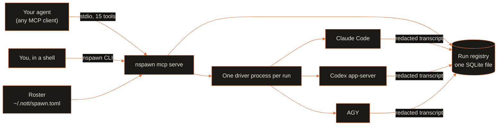

<p align="center">
  
  
</p>

<p align="center">
  <a href="../../LICENSE"></a>
  <a href="pyproject.toml"></a>
  <a href="https://modelcontextprotocol.io"></a>
  <a href="https://github.com/menot-you/n-spawn/releases"></a>
  <a href="https://github.com/menot-you/n-spawn/stargazers"></a>
</p>

**Run many Claude Code and Codex agents at once. They outlive your terminal and never write over each other.**

## Install

```bash
curl --proto '=https' --tlsv1.2 -fsSL https://no.tt/install.sh | sh
```

Or install from source. You need [uv](https://docs.astral.sh/uv/) and Git. uv installs the pinned Python (3.14):

```bash
git clone https://github.com/menot-you/n-spawn
cd n-spawn
uv sync
uv run nspawn --help
```

nSPAWN is not on PyPI today.
The [installation guide](../../docs/INSTALLATION.md) shows how to register the MCP server in your client.

## How it works



Each provider runs its own native CLI, logged in with your own account. There is no proxy.

## By the numbers

<p align="center">
  
  
</p>

Counted on 2026-10-21. Tools: the MCP `tools/list` request to `nspawn mcp serve`.
Tests: `uv run --group dev pytest --collect-only -q` in each member root.

## Why

| Without nSPAWN | With nSPAWN |
| --- | --- |
| A subagent dies when you close the terminal. | Each run has its own driver process. It keeps running, and you read the result later. |
| Two agents edit the same checkout and break each other's work. | A writable run takes an exclusive claim on its worktree. Read-only runs cannot write. |
| One account hits its 5-hour or 7-day limit and the whole job stops. | nSPAWN tracks usage per account and sends work to an account that still has capacity. |
| The reviewer shares the author's context, so it agrees with the author. | `nspawn_review_start` opens a fresh read-only session with no shared context. |
| Raw agent logs can hold tokens and secrets. | nSPAWN removes the account credentials it holds from transcripts before it stores them. Other secrets in a transcript stay. |

## Quick start

Create the local store and a roster of providers:

```bash
uv run nspawn database create
mkdir -p ~/.nott && cp -n templates/nott/spawn.toml ~/.nott/spawn.toml
uv run nspawn provider list
uv run nspawn quota show
```

The template holds no credentials.
Each provider uses its own native CLI, logged in with your own account.

Then start a read-only run from any MCP client:

```json
{
  "tool": "nspawn_run_start",
  "arguments": {
    "cwd": "/path/to/repository",
    "read_only": true,
    "class": "review",
    "prompt": "Summarize the package entry points in two sentences."
  }
}
```

Read the answer with `nspawn_result_show` and the run `run_id`.
Close the run with `nspawn_run_close`.
To send one prompt to several providers at once, use `nspawn_batch_start`.

## What you get

- **15 MCP tools and a CLI** to start, list, show, read and close runs.
- **Native clients, no proxy.** Each provider runs its own CLI: Claude Code, Codex `app-server` or AGY.
- **Safe stops.** nSPAWN checks the process id, start time and user before it sends a signal.
- **Resume.** A finished run keeps its vendor thread id, so you can continue the session.
- **Honest records.** nSPAWN keeps the effort you asked for apart from the effort the vendor ran.
  Quota state says when a reading is old or missing.
- **Task classes.** Each run declares a class (for example `review` or `mechanical_fanout`).
  The roster ranks providers per class, so cheap work goes to cheap accounts.

Every test uses its own temporary SQLite store and fake vendor clients.
No test needs a paid account:

```bash
TMPDIR=/var/tmp uv run --group dev pytest tests -q
```

## The NOTT family

<table>
<tr>
<td align="center" width="20%"><a href="https://github.com/menot-you/n-memory"></a><br><sub>Memory that cites its source.</sub></td>
<td align="center" width="20%"><a href="https://github.com/menot-you/n-spawn"></a><br><sub>Tracked, resumable agent workers.</sub></td>
<td align="center" width="20%"><a href="https://github.com/menot-you/n-browser"></a><br><sub>The live web as cited evidence.</sub></td>
<td align="center" width="20%"><a href="https://github.com/menot-you/n-apple"></a><br><sub>App Store Connect for agents.</sub></td>
<td align="center" width="20%"><a href="https://github.com/menot-you/plugin"></a><br><sub>The team contract, routes and hooks.</sub></td>
</tr>
</table>

## For AI agents

This section is for a language model that reads this repository.

- **What it is.** nSPAWN is a supervisor for AI coding agents. It starts Claude
  Code, Codex and AGY sessions through their own native CLIs, records each run
  in a local SQLite registry, and lets a client read the result later.
- **What it is not.** It is not an API proxy, a model host or a credential
  store for other tools. It does not share one vendor CLI across providers.
- **Entry points.** The CLI is `nspawn <noun> <verb>` (`nspawn --help`).
  The MCP server is `nspawn mcp serve` (stdio). All 15 tool names start with
  `nspawn_`. Start with `nspawn_provider_list`, `nspawn_run_start`,
  `nspawn_result_show` and `nspawn_run_close`.
- **Configuration.** The provider roster is `~/.nott/spawn.toml`. The template
  is `templates/nott/spawn.toml` and holds no credentials. The store directory
  is `~/.nott/state/database/`, or `NOTT_DATABASE_DIR` when a test sets it.
- **Invariants.** Each run has its own driver process. A writable run holds an
  exclusive claim on its worktree. A signal goes only to a process whose id,
  start time and user match the record. A test never opens the live store or
  a paid account.
- **Full reference.** [docs/REFERENCE.md](../../docs/components/nspawn/REFERENCE.md) lists every tool
  and command. [RULEBOOK.md](RULEBOOK.md) lists the implementation rules.
  [llms.txt](https://github.com/menot-you/n-spawn/blob/main/llms.txt) holds the same facts in the llms.txt format.

## Documentation

| Need | Page |
| --- | --- |
| How it works, and the full design and contract | [Architecture](../../docs/components/nspawn/ARCHITECTURE.md) |
| Every MCP tool and CLI command | [Reference](../../docs/components/nspawn/REFERENCE.md) |
| Setup, operation, backup and restore | [Runbook](../../docs/components/nspawn/RUNBOOK.md) |
| A first contribution | [Docs index](../../docs/components/nspawn/README.md) |
| Development setup and checks | [Setup](../../docs/components/nspawn/SETUP.md), [Quality](../../docs/components/nspawn/QUALITY.md) |
| Installation | [Installation](../../docs/INSTALLATION.md) |
| Data and privacy | [Privacy](../../docs/PRIVACY.md) |
| Upgrades | [Upgrade](../../docs/UPGRADE.md) |
| Failures | [Troubleshooting](../../docs/TROUBLESHOOTING.md) |
| Direction and changes | [Roadmap](../../docs/ROADMAP.md), [Changelog](../../CHANGELOG.md) |
| Implementation rules | [Rulebook](RULEBOOK.md) |

## Contribute

Issues and pull requests are welcome.
If a vendor CLI update changes a stream frame, a quota header or a sandbox flag, open an issue.
Include the redacted frame and the client version.

Read [contributing](../../CONTRIBUTING.md), [conduct](../../CODE_OF_CONDUCT.md) and [support](../../SUPPORT.md).
Report security issues through [security](../../SECURITY.md).

nSPAWN is free software under the [AGPL-3.0](../../LICENSE). See the [citation](../../CITATION.cff).
