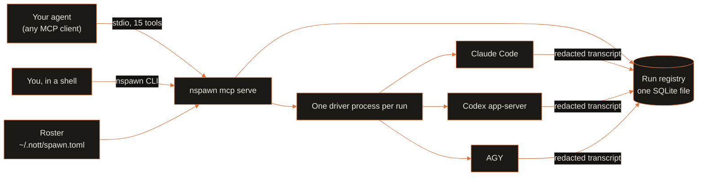

<p align="center">
  
  
</p>

<p align="center">
  <a href="../../LICENSE"></a>
  <a href="pyproject.toml"></a>
  <a href="https://modelcontextprotocol.io"></a>
  <a href="https://github.com/menot-you/n-spawn/releases"></a>
  <a href="https://github.com/menot-you/n-spawn/stargazers"></a>
</p>

**Run many Claude Code and Codex agents at once. They outlive your terminal and never write over each other.**

## Install

```bash
curl --proto '=https' --tlsv1.2 -fsSL https://no.tt/install.sh | sh
```

Or install from source. You need [uv](https://docs.astral.sh/uv/) and Git. uv installs the pinned Python (3.14):

```bash
git clone https://github.com/menot-you/n-spawn
cd n-spawn
uv sync
uv run nspawn --help
```

nSPAWN is not on PyPI today.
The [installation guide](../../docs/INSTALLATION.md) shows how to register the MCP server in your client.

## How it works



Each provider runs its own native CLI, logged in with your own account. There is no proxy.

Registry reads do not join the writer queue when the schema is current.
`run show`, `run list --live`, and related read commands register no instance.
Their MCP supervisor starts no heartbeat or slice reconciliation worker.
A read records proven driver loss through `mark_orphans` and arms its terminal notice.
Reads with nothing to record take no write lock or write transaction.
Old schemas still require a write transaction for migration.
Write commands retain instance registration and the normal supervisor lifecycle.

## By the numbers

<p align="center">
  
  
</p>

Counted on 2026-10-21. Tools: the MCP `tools/list` request to `nspawn mcp serve`.
Tests: `uv run --group dev pytest --collect-only -q` in each member root.

## Why

| Without nSPAWN | With nSPAWN |
| --- | --- |
| A subagent dies when you close the terminal. | Each run has its own driver process. It keeps running, and you read the result later. |
| Two agents edit the same checkout and break each other's work. | A writable run takes an exclusive claim on its worktree. Read-only runs cannot write. |
| One account hits its 5-hour or 7-day limit and the whole job stops. | nSPAWN tracks usage per account and sends work to an account that still has capacity. |
| The reviewer shares the author's context, so it agrees with the author. | `nspawn_review_start` opens a fresh read-only session with no shared context. |
| Raw agent logs can hold tokens and secrets. | nSPAWN removes the account credentials it holds from transcripts before it stores them. Other secrets in a transcript stay. |

## Quick start

Create the local store and a roster of providers:

```bash
uv run nspawn database create
mkdir -p ~/.nott && cp -n templates/nott/spawn.toml ~/.nott/spawn.toml
uv run nspawn provider list
uv run nspawn quota show
```

The template holds no credentials.
Each provider uses its own native CLI, logged in with your own account.

Then start a read-only run from any MCP client:

```json
{
  "tool": "nspawn_run_start",
  "arguments": {
    "cwd": "/path/to/repository",
    "read_only": true,
    "class": "review",
    "prompt": "Summarize the package entry points in two sentences."
  }
}
```

Read the answer with `nspawn_result_show` and the run `run_id`.
Close the run with `nspawn_run_close`.
To send one prompt to several providers at once, use `nspawn_batch_start`.

## Steer a live run

A Claude run takes more than one message.
The driver starts the child with `--input-format stream-json` and sends the prompt as the first user message.
To add a message to a live run, run:

```bash
nspawn turn send <run-id> <text>
```

The command queues one user message and exits 0.
It exits 2 for a run that is not live, that is, a run the store does not hold, a run in a terminal phase, or a run whose driver sealed the channel.
The driver writes each message to the child in send order.
It closes stdin after a result that the child gave since the last message was written, when no message waits.
The client can fold messages that arrive during one turn into that turn and give one result for them.
`nspawn_transcript_show` returns the answer of the child to each message.

## Read paths and native writers

`read_paths` requires `read_only=true`. Reviews and batches are always read-only.
nSPAWN refuses `native_write` with `read_paths` before it creates a run, claim or child.
Drop `read_paths` for a native writer. It uses ordinary native access without this field.
Native writers start in their standalone clones without nSPAWN writer sandbox settings.
Claude keeps ordinary settings, the inherited environment and plugin hooks.
Writer plugins do not load the nSPAWN MCP server.
Codex and AGY receive no adapter writer permission profile.
The one-writer claim and process custody remain. Node cages remain.
A read-only run, a review included, starts the native client with the tools of its agent file and no other tool.
It starts in a run slice of its own and has no bwrap settings.
Or use `read_only=true` without `native_write` for a reader.
The same rule applies to `session_id` resumes and `original_run` continuations.

## Native-writer RED admission

Native writers have two admitted roles: `class="implementation"` requires
`red_record=".nott/plans/<plan>/red/<unit>.json"`; `class="verification"` remains
usable without RED for verification work. All other or unresolved writer classes
are refused. Read-only runs and read-only reviews retain their existing scope.
Do not relabel implementation work as verification.

Produce the bundle with `nott plan test .nott/plans/<plan>/tests/<unit>.md
--base <full-clone-HEAD> --branch <containing-origin-branch>` before starting the
implementation writer. The origin branch must already contain that commit. Every
selected test must have an observed assertion failure (exit 1); errors, passes and
timeouts are not RED. Both bounded regular files must match exactly, without
symlink traversal. Admission executes neither commands nor code from the bundle.
These local artifacts are not signed and do not defeat same-account fabrication.

Every continuation, session resume and failover attempt needs explicit current
exact-HEAD evidence; it cannot inherit the previous receipt. A keyed reattachment
returns the existing run and receipt, not a new certification of mutable files.
`nspawn_run_show.red_record` reports the retained locator, or null without a receipt.
The app sends that locator explicitly on execution follow-up. nSPAWN checks it
against the current HEAD again. A witness refusal reaches the app as plain text.
Initial workflow prepared-HEAD drift requires revise-and-readmit, including new
compiled witnesses, review and check readback, cancellation of the old workflow,
and a new workflow identity. Cures and repairs instead wait for a distinct bundle
at the saved reviewed head before resuming the same builder with `original_run`.

`nspawn run list --since 1970-01-01T00:00:00Z` includes all retained authorized
rows, including terminal and verification writers, with `execution_class`,
`red_admission`, `red_admission_reason` and `red_receipt`. States are `valid`,
`missing`, `invalid`, `unknown` and `not_required`; historical nonimplementation
writers are `not_required`, not permission for a new writer role. Evidence comes
from the immutable admission journal, not the current clone. A history read
failure exits nonzero without successful partial JSON. Pruned history is not
covered, and missing evidence does not prove tests never ran.

## Optional operation declarations

Worker starts, reviews and batches still validate the optional `operations`
version-1 declaration. It states requirements, never grants authority.
The writer cage matcher is removed. New runs report `operation_admission.checked`
as false, including runs with nonempty declarations. No declaration proves tool,
filesystem, network or task compatibility. Historical checked evidence remains
readable without recomputing it against current settings.

See [the operation reference](../../docs/components/nspawn/REFERENCE.md#optional-operations) for the schema.

## What you get

- **15 MCP tools and a CLI** to start, list, show, read and close runs.
- **Native clients, no proxy.** Each provider runs its own CLI: Claude Code, Codex `app-server` or AGY.
- **Safe stops.** nSPAWN checks the process id, start time and user before it sends a signal.
- **Resume.** A finished run keeps its vendor thread id, so you can continue the session.
- **Honest records.** nSPAWN keeps the effort you asked for apart from the effort the vendor ran.
  Quota state says when a reading is old or missing.
- **Task classes.** Each run declares a class (for example `review` or `mechanical_fanout`).
  The roster ranks providers per class, so cheap work goes to cheap accounts.
- **Session journal.** `nspawn session serve`, a user unit that starts at boot,
  translates each live Claude session on the host into NOTT rows in the same store,
  about 1 s behind the source. `nspawn session list [<vendor>] [--id <id>]... [--since <ISO>] [--count]`
  and `nspawn session show <vendor> <id>` print them as JSON lines with the token totals.
  The journal imports each main session `projects/<project>/<session>.jsonl` with the id `<session>`.
  It imports each Agent-tool subagent `<parent>/subagents/agent-<agent>.jsonl` and each Workflow agent
  `<parent>/subagents/workflows/wf_<id>/agent-<agent>.jsonl` with the id `<parent>.<agent>`,
  the parent `<parent>` and the parent evidence `source`.
  A `finished: true` sidecar (`agent-<agent>.meta.json`) ends an Agent-tool subagent until the
  journal proves a later turn line by its own reads. A SendMessage resume keeps that sidecar.
  A turn line is a user line, a queued command or an agent record that came after the sidecar.
  The proof has three parts. The journal read the sidecar. The line starts at or after the size
  of the next `lstat` of the transcript. The sidecar did not change after that read. Then the
  subagent is `live` while its parent's process holds it and its turn is open, else `ended`.
  A cycle that cannot read the transcript has no proof, and the subagent is `ended`.
  Teammates and Workflow agents keep the `finished` rule.
  A Workflow agent has no `finished` metadata key. Its status is `ended` when the workflow's
  `journal.jsonl` has its `result` line, and `failed` when it has its `failed` line.
  A Workflow that stops writes no line for its agents in flight. The journal tracks a Workflow
  run from the launch result of a new run (a Workflow call with no `resumeFromRunId`) that it
  reads in the main session. A resume adds a launch to a tracked run. A task notification of
  the parent ends the launch that its tool-use id names. The notification is a user turn with
  the origin `task-notification`, or a `queued_command` attachment with that command mode.
  When each launch of a run has an end, the journal closes the run in three steps. First, a
  parent read holds the end, with no unread byte, no partial record and no Workflow call that
  waits for its result. Second, the journal lists the run folder `wf_<id>/` one time,
  completely. Third, a parent read of a later cycle still holds the end, with no new call.
  After a failed listing or a later call, the journal does the steps again. A failed listing
  keeps the run. Its error code is the reason of the status row of each agent of the run with
  no end line and no certificate. One log line names the folder for each new reason.
  Each agent file of that listing is a member. A member with no `result` or `failed` line gets
  a terminal certificate in its own state and the status `failed`. The certificate holds the
  agent id, the run id and the call id. It also holds the device, inode and size of the agent
  file, and the number of `started` lines of the agent in the Workflow journal. Growth, a
  smaller size, another device or another inode voids the certificate. A new `started` line
  of the agent voids it too, also when the agent has its own end line. As on main, that end
  line stays the status of the agent. On this host, 443 Workflow calls and 433 launch results
  name no agent id. So this line of a later launch is the record that names the agent.
  One function decides whether a certificate is void. Each reader of a certificate calls it
  before it uses the certificate. The readers are the member check, the reconciliation and the
  retirement of a closed run, and the status of the agent. The function compares the device,
  inode and size of the agent file. It also compares the count of `started` lines of the agent
  in the Workflow journal that the sweep read. It deletes a void certificate before the reader
  acts, also while the journal tracks the run. Then the agent gets the other rules again. While
  the journal tracks its closed run, the agent gets a new certificate for the current file and
  journal.
  A smaller or replaced file also gets the refusal of the journal (`source shrank` or
  `transcript replaced`). A change of the modification time alone keeps the certificate. A
  restart keeps each certificate that no event voided.
  The producer model bounds this rule. Claude Code only appends to an agent file, and it gives
  each launch new agent ids. A rewrite of an agent file in place with the same length comes
  from another writer, outside that model. It keeps the certificate, and a stopped agent keeps
  `failed`. A measurement on this host on 2026-10-28 read each agent file of the Workflow runs
  two times, 30 minutes apart (4500 files, 5.06 GB). No file shrank, changed in place or got
  another device or inode. The one file that grew kept its earlier bytes as its prefix. The
  4505 `started` lines of 373 run journals name each agent id one time.
  The entry of a closed run keeps all its members, and each sweep checks each member again. The
  run leaves the parent's state only when each member holds a valid certificate, its own end
  line or a refusal. The parent keeps only Workflow calls that wait for a result, runs with an
  open launch, and closed runs that wait for the three steps or for a member's certificate.
  The status changes at the status sweep of the third step. For a parent that does not change,
  that is the next cold cycle, 5 s after the sweep of the first step. An unread parent byte,
  a partial record, a waiting Workflow call or a deferred parent delays it. A member that no
  scan found yet gets its certificate at the first sweep after the journal reads it.
  This rule depends on the order in which Claude Code writes the files. A measurement on this
  host on 2026-10-28, over 17 main sessions, 361 runs and 4493 agent files, shows that order.
  Claude Code created each agent file at least 0.214 s after the record time of its launch
  call. When each launch of a run had an end, each agent file existed before that end (at
  least 0.044 s). Claude Code created or wrote no agent file after that end and before the
  next call of the run. An earlier launch with no end can create agents after the end of a
  later launch (32 agents in 6 runs), so the journal waits for the end of each launch.
  The journal gives no inferred status to an agent of a launch that it read before this
  release, or of a resume of a run whose first launch it did not read or that it already
  retired. It gives none for a run that has a launch with no end. It also gives none for a
  Workflow journal that it refuses or that ends in a partial record, and for a parent with no
  retained source identity. These agents keep the other rules. The journal reads no parent
  byte for this rule.
  The status rules decode the state of a source once for each change of it.
  A journal that the reader refuses gives no status. The agent then gets the status of an
  Agent-tool subagent, and the refusal is the reason of its status row. This is also true for
  an agent with a terminal certificate, because the refused journal can hold a later `started`
  line of the agent. The certificate stays, and the next read of the journal keeps it or voids
  it.
  The spill files of a subagent and of a Workflow agent are in `<parent>/tool-results/`.
  For a resolved source home `~/.nott/state/nspawn/runs/<run>/<vendor>`, the top-level
  session's list entry and shown rows have `run`, the owning run id, regardless of its phase.
  Subagents and teammates under `subagents/` have no `run` field, even in a run home.
  Other homes and homes that cannot resolve have no `run` field.
  Only the show footer carries `native_activity` from the last journal import.
  A list entry has no `native_activity`, and the list reads no import activity.
  `nspawn session list <vendor> --id <id>` keeps the session `<id>` and each session whose
  id starts with `<id>.`: its copies in other homes and its subagents. The filter
  searches the primary key of `journal_session`. `--count` ends the reply with
  `{"count":N}`, where N is the number of session lines before it. A complete
  empty list is the single line `{"count":0}`. Without `--count`, the reply has only session lines.
  CLI list entries also carry `source_home`: the `source.home` of the session's one `session` row.
  When the session has no `session` row or more than one, or the row names another vendor or id,
  `source_home` is null and `source_home_refusal` gives `session row is not unique` or
  `session identity does not match`. Otherwise `source_home_refusal` is null.
  The list reads at most two `session` rows through the `journal_session_row` index.
  The writer commits activity with its cursor, including nested snapshot clocks and at most 256 recent gaps.
  Byte `size` excludes any unfinished record. `max_gap_seconds` keeps the all-time maximum.
  Readers never reopen vendor files. One export gate checks both journal statuses and current metadata.
  It requires matching device, inode, size and nanosecond mtime, with size equal to the consumed cursor.
  The source must remain owner-held, readable, regular and single-linked under owner-controlled directories.
  A failed gate exports only a safe `reason`. Growth and unfinished records stay unknown until imported.
  Rebuilds use retained device and inode only. Legacy sources without retained identity keep activity unknown.
  A malformed record or invalid clock makes activity unknown but does not stop translation.
  Stored rows and token totals stay unchanged.
  `tools/mcp.sh install nspawn` installs and enables the unit (RULEBOOK.md, row LJ).

The operation-admission stdio fixture copies the synced checkout's
`.venv/bin/nspawn` entry point into each test's private directory. Run `uv sync`
at the repository root first. Set `NOTT_NSPAWN_OPERATION_TEST_BINARY` to an absolute
candidate executable path to test another runtime. An invalid override fails
without fallback. Each check pins the executable's SHA-256 and runs from a neutral
directory without `PYTHONPATH`. These checks are not yet the complete
native/installed M6 qualification judge.

Every test uses its own temporary SQLite store and fake vendor clients.
No test needs a paid account:

```bash
TMPDIR=/var/tmp uv run --group dev pytest tests -q
```

## The NOTT family

<table>
<tr>
<td align="center" width="20%"><a href="https://github.com/menot-you/n-memory"></a><br><sub>Memory that cites its source.</sub></td>
<td align="center" width="20%"><a href="https://github.com/menot-you/n-spawn"></a><br><sub>Tracked, resumable agent workers.</sub></td>
<td align="center" width="20%"><a href="https://github.com/menot-you/n-browser"></a><br><sub>The live web as cited evidence.</sub></td>
<td align="center" width="20%"><a href="https://github.com/menot-you/n-apple"></a><br><sub>App Store Connect for agents.</sub></td>
<td align="center" width="20%"><a href="https://github.com/menot-you/plugin"></a><br><sub>The team contract, routes and hooks.</sub></td>
</tr>
</table>

## For AI agents

This section is for a language model that reads this repository.

- **What it is.** nSPAWN is a supervisor for AI coding agents. It starts Claude
  Code, Codex and AGY sessions through their own native CLIs, records each run
  in a local SQLite registry, and lets a client read the result later.
- **What it is not.** It is not an API proxy, a model host or a credential
  store for other tools. It does not share one vendor CLI across providers.
- **Entry points.** The CLI is `nspawn <noun> <verb>` (`nspawn --help`).
  The MCP server is `nspawn mcp serve` (stdio). All 15 tool names start with
  `nspawn_`. Start with `nspawn_provider_list`, `nspawn_run_start`,
  `nspawn_result_show` and `nspawn_run_close`.
- **Configuration.** The provider roster is `~/.nott/spawn.toml`. The template
  is `templates/nott/spawn.toml` and holds no credentials. The supervisor,
  the route verbs, the AGY ACP shim, System1 and the journal writer read the
  roster through one function, `owner_roster.read_roster`. It reads
  `NOTT_NSPAWN_ROSTER` only when that file is absent. A route verb refuses an unreadable roster without a host path.
  The store directory is `~/.nott/state/database/`, or `NOTT_DATABASE_DIR`
  when a test sets it.
- **Invariants.** Each run has its own driver process. A writable run holds an
  exclusive claim on its worktree. Before admission, the driver of a run in a
  git tree holds a shared flock on `nott-run.lease` in the git dir of that tree
  until it exits, so `tools/worktree.sh collect` keeps that tree. A route ping
  runs in the stdio, and the stdio holds that lease until it exits. Each holder
  finds the git dir under a shared flock on `worktree-collect.lock` in the
  store directory of the admitting registry, which the collector holds while
  it has the `.git` of a tree moved aside. A driver with a private `NOTT_DATABASE_DIR`
  has its own lock, which the live collector does not hold. A signal goes
  only to a process whose id, start time and user match the record. A test
  never opens the live store or a paid account.
- **Full reference.** [docs/REFERENCE.md](../../docs/components/nspawn/REFERENCE.md) lists every tool
  and command. [RULEBOOK.md](RULEBOOK.md) lists the implementation rules.
  [llms.txt](https://github.com/menot-you/n-spawn/blob/main/llms.txt) holds the same facts in the llms.txt format.

## Busy store and worker diagnostics

A busy record count is skipped after `BusyError`.
One short log line names the run and the skipped write, without exception text or a chain.
The worker does not retry, sleep, or restart the vendor turn.
Lifecycle, custody, quota, wall, and terminal writes keep their existing behavior.
Required native usage snapshots also keep their existing named failure path.
The lock timeout and terminal retry queue do not change.
Record counts are a cache of retained stdout, not resume evidence.
A fresh count observation uses the full stream. Status rebuilds a zero count from that stream.
A skipped count increment is not replayed by terminal publication.

Each run keeps worker exception types and stack frames in its private `worker_errors` file.
The log includes causes and contexts, even when an exception suppresses its context.
It omits exception messages, source text, and locals to keep credential values out.
Its 64 KiB ceiling keeps the newest entry and marks older text that it cuts.
Busy observations do not write to this file.
A diagnostic file failure logs only the I/O error type and the original exception type.
It does not change the run's result.

## Documentation

| Need | Page |
| --- | --- |
| How it works, and the full design and contract | [Architecture](../../docs/components/nspawn/ARCHITECTURE.md) |
| Every MCP tool and CLI command | [Reference](../../docs/components/nspawn/REFERENCE.md) |
| Setup, operation, backup and restore | [Runbook](../../docs/components/nspawn/RUNBOOK.md) |
| A first contribution | [Docs index](../../docs/components/nspawn/README.md) |
| Development setup and checks | [Setup](../../docs/components/nspawn/SETUP.md), [Quality](../../docs/components/nspawn/QUALITY.md) |
| Installation | [Installation](../../docs/INSTALLATION.md) |
| Data and privacy | [Privacy](../../docs/PRIVACY.md) |
| Upgrades | [Upgrade](../../docs/UPGRADE.md) |
| Failures | [Troubleshooting](../../docs/TROUBLESHOOTING.md) |
| Direction and changes | [Roadmap](../../docs/ROADMAP.md), [Changelog](../../CHANGELOG.md) |
| Implementation rules | [Rulebook](RULEBOOK.md) |

## Contribute

Issues and pull requests are welcome.
If a vendor CLI update changes a stream frame, a quota header or a sandbox flag, open an issue.
Include the redacted frame and the client version.

Read [contributing](../../CONTRIBUTING.md), [conduct](../../CODE_OF_CONDUCT.md) and [support](../../SUPPORT.md).
Report security issues through [security](../../SECURITY.md).

nSPAWN is free software under the [AGPL-3.0](../../LICENSE). See the [citation](../../CITATION.cff).
